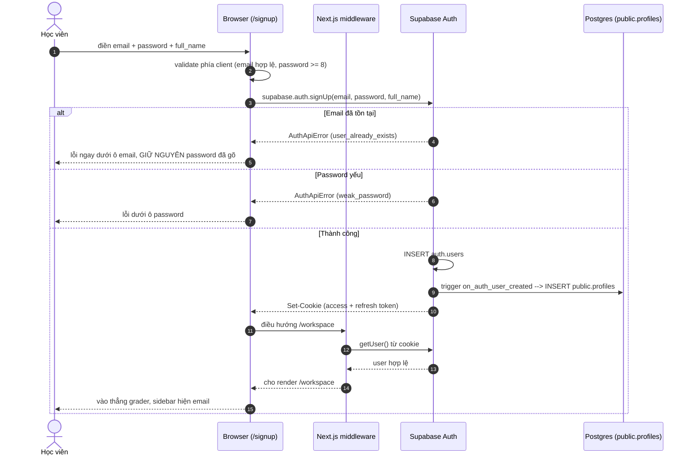
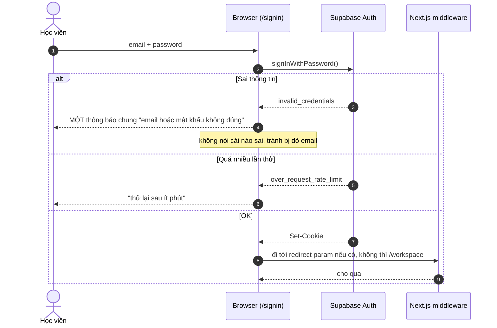
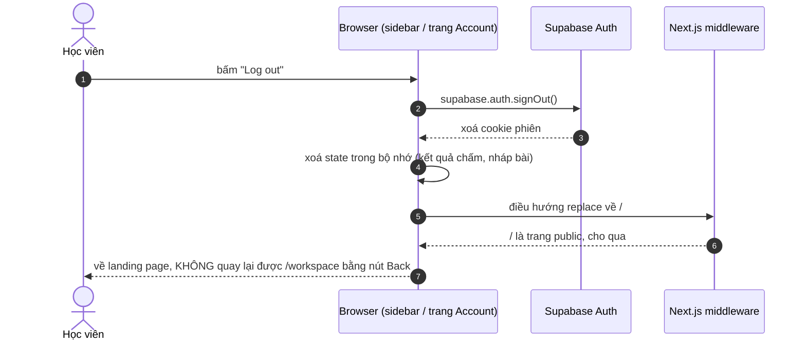
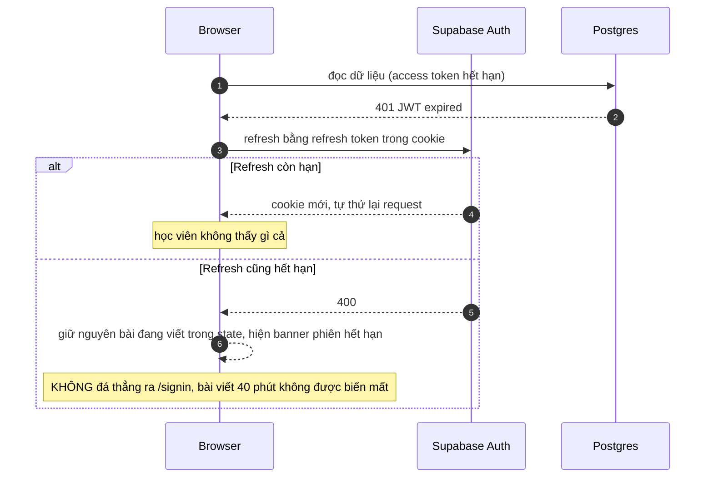
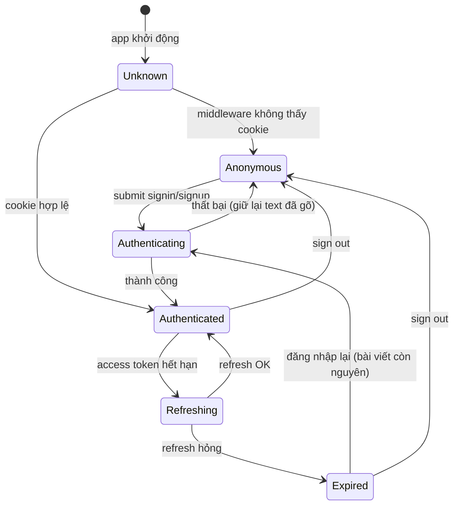
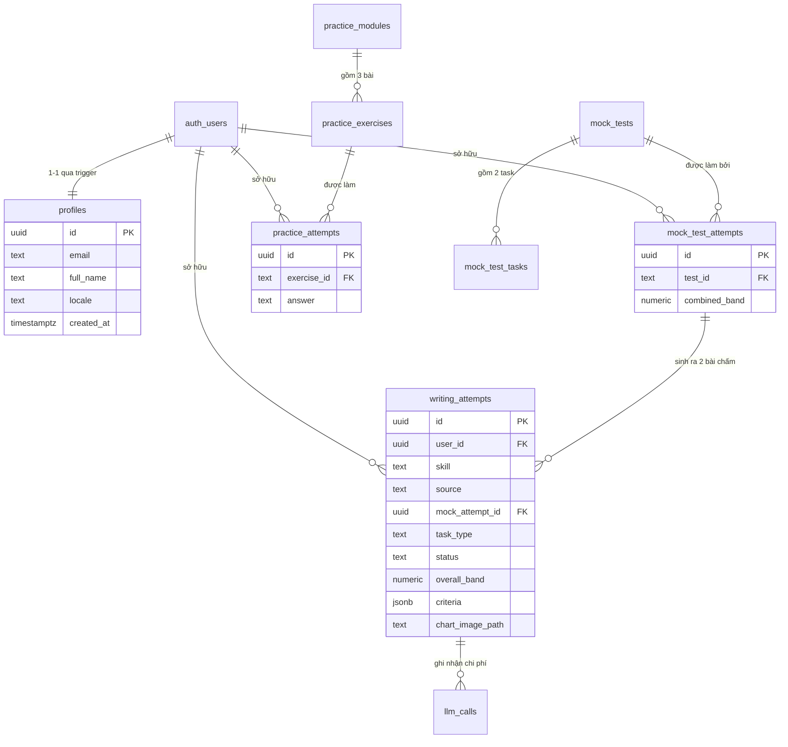
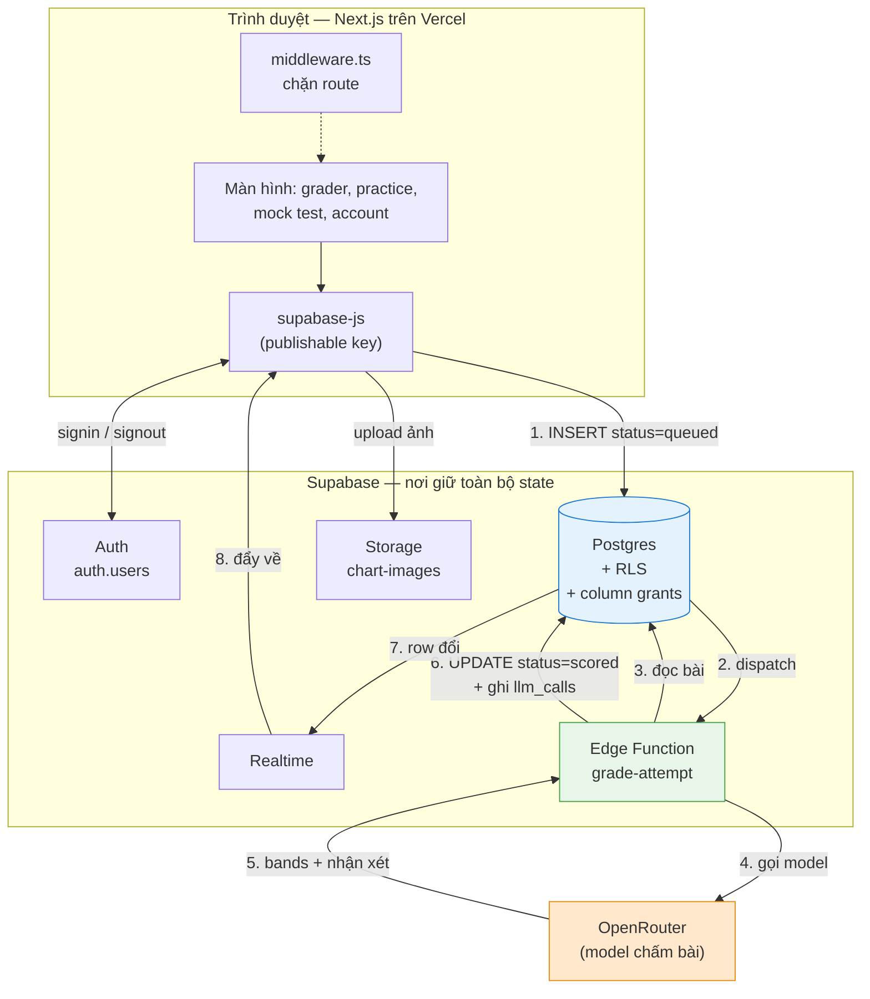
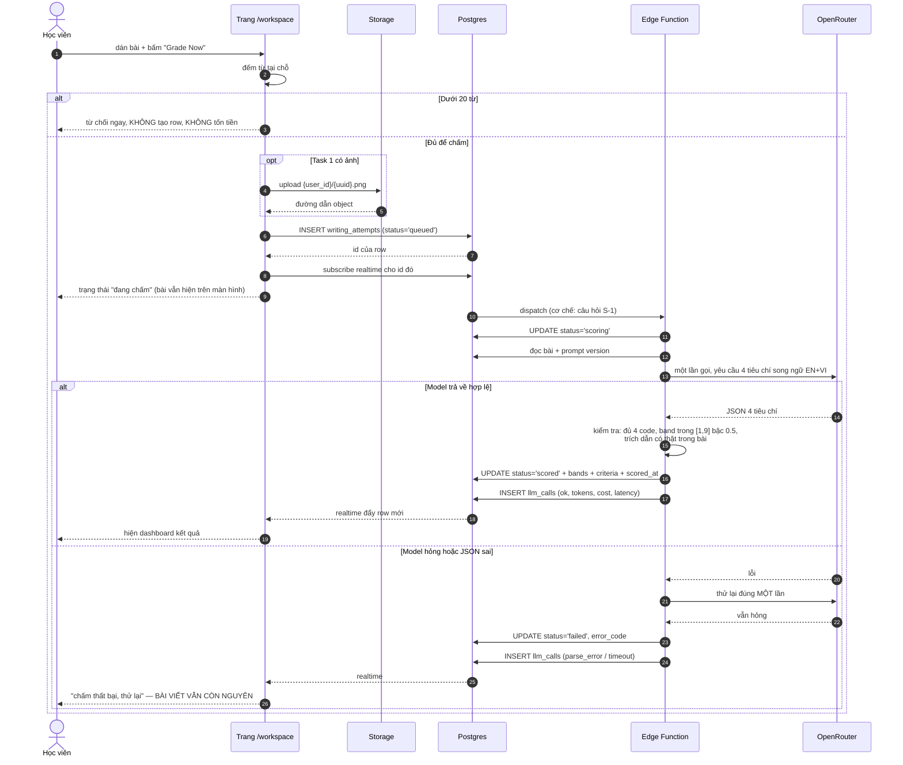
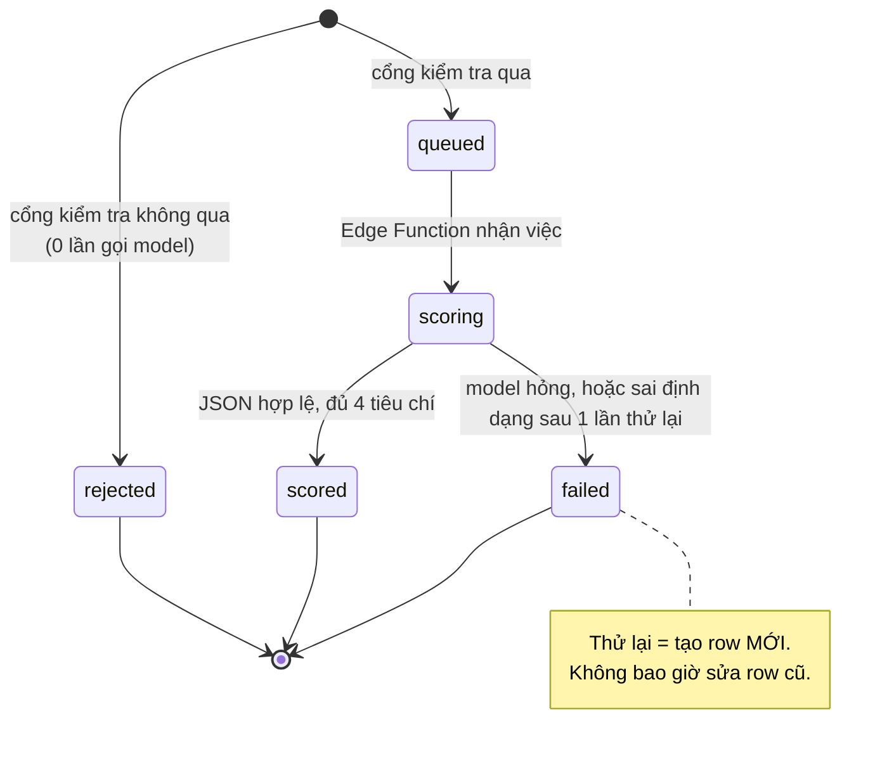
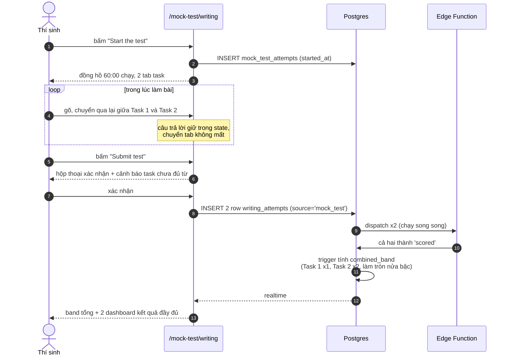

# CLARIFICATION — Nền tảng Supabase cho WriteWise

> Tài liệu **làm rõ yêu cầu trước khi viết spec**. Đây không phải spec, không phải kế hoạch
> triển khai. Nó ghi lại: điều gì đã được xác minh, điều gì bạn đã quyết, điều gì còn mở, và
> **mỗi hạng mục cần được đặc tả chi tiết đến mức nào**.
>
> Trạng thái: ✅ **Đã duyệt toàn bộ 2026-08-23** — trừ hai mục hoãn có chủ đích (S-8, S-9).
> Tài liệu chốt sinh ra từ đây: [docs/data-model.md](./docs/data-model.md) ·
> [docs/system-architecture.md](./docs/system-architecture.md) · [TODO.md](./TODO.md) ·
> [supabase/migrations/](./supabase/migrations/)

---

## Cách đọc mức độ chi tiết

Mỗi field được gán một mức. Mức quyết định **spec sau này phải viết bao nhiêu** cho field đó —
không phải mức độ quan trọng, mà là mức độ *tốn kém nếu hiểu sai*.

| Mức | Nghĩa | Spec phải có |
|---|---|---|
| 🟢 **Low** | Sai thì sửa trong một lần commit, không ảnh hưởng gì khác | Một câu quyết định |
| 🟡 **Medium** | Sai thì phải sửa nhiều nơi, nhưng dữ liệu không mất | Bảng field, danh sách input/output, ràng buộc |
| 🔴 **High** | Sai thì phải migrate dữ liệu hoặc viết lại cả luồng | Sequence diagram + state machine + I/O + checklist + tiêu chí đạt |

Trạng thái: ✅ đã chốt · ⏳ chờ bạn trả lời · 💭 tôi đề xuất mặc định, bạn chỉ cần gật

---

## 0. Ngữ cảnh đã **xác minh** (không phải giả định)

Tôi đã gọi trực tiếp vào Supabase REST API bằng key trong `.env` để kiểm tra, thay vì tin vào mô tả.

| Điều được kiểm tra | Kết quả thật |
|---|---|
| Bảng `public.users` | ❌ **Không tồn tại.** Cái bạn nhớ có lẽ là `auth.users` — bảng do Supabase Auth tự quản, ta không được sửa |
| Bảng `public.profiles` | ✅ Tồn tại — `id`, `email`, `full_name`, `created_at`, `updated_at` |
| Bảng `public.writing_attempts` | ✅ Tồn tại nhưng **chỉ 5 cột**: `id`, `user_id`, `overall_band`, `created_at`, `test_id`. Chưa có `task_type`, `essay_text`, `criteria`, `status` |
| Bảng khác (`grader_results`, `llm_calls`, `practice_*`, `mock_tests`…) | ❌ Chưa có bảng nào |
| `supabase/migrations/` trong repo | ❌ Không tồn tại → schema hiện tại tạo tay trên dashboard, **không reproducible** |
| Định dạng key trong `.env` | `sb_publishable_…` (định dạng mới), **không phải** JWT `anon` cũ |
| `@supabase/supabase-js` trong frontend | ❌ Chưa cài. `package.json` chỉ có `motion`, `next`, `react`, `react-dom` |
| Code backend | ❌ Không có. `stitch_ai_ielts_writing_evaluator/` chỉ chứa `code.html` + `screen.png` |

### Ràng buộc từ constitution (`.specify/memory/constitution.md` v3.1.1)

Ba điều dưới đây là **NON-NEGOTIABLE** trong constitution và đã định hình sẵn phần lớn câu trả lời:

- **Principle VIII** — Frontend chỉ nói chuyện với Supabase. Không gọi thẳng compute endpoint.
  Việc được dispatch bằng cách **ghi một row có cột `status`**, rồi theo dõi row đó đổi trạng thái.
- **Principle VII** — `service_role` key và `OPENROUTER_API_KEY` không bao giờ lọt vào bundle client.
  Mọi lần gọi model phải được ghi lại (bảng `llm_calls`).
- **Development Workflow** — Thay đổi schema **phải** là file migration trong repo. Sửa qua dashboard
  không tính là xong.

> ⚠️ `OPENROUTER_API_KEY` đang nằm trong `.env` ở thư mục gốc. `.env` **có** trong `.gitignore`
> (đã kiểm tra) nên chưa lộ, nhưng key này phải được nạp vào Edge Function bằng
> `supabase secrets set`, không bao giờ đi qua `NEXT_PUBLIC_*`.

---

# Task 1 — Authentication với Supabase

**Yêu cầu gốc của bạn:** *"sign up được, signin được, signout được."*

Ba động từ đó nghe đơn giản, nhưng chúng kéo theo bốn thứ không có trong câu: phiên sống ở đâu,
ai chặn trang khi chưa đăng nhập, row `profiles` sinh ra lúc nào, và chuyện gì xảy ra khi
access token hết hạn giữa lúc đang viết bài. Phần này làm rõ cả bảy.

## 1.1 Quyết định đã chốt

| # | Field | Quyết định | Mức | Trạng thái |
|---|---|---|---|---|
| A-1 | Xác thực email | **Tắt** `Confirm email` trong Supabase Auth. Sign up xong có session ngay | 🔴 High | ✅ |
| A-2 | Nơi giữ phiên | `@supabase/ssr` — session trong **cookie**, Next.js **middleware** chặn route | 🔴 High | ✅ |
| A-3 | Phương thức đăng nhập | Email + password | 🟢 Low | ✅ |

> **A-1 kéo theo:** không cần `/verify-email`, không cần `/auth/callback`, không cần nút gửi lại
> email. Ba màn hình biến mất khỏi scope. Nhưng cũng có nghĩa **bất kỳ ai cũng đăng ký được bằng
> email không có thật** — chấp nhận được ở giai đoạn này, phải bật lại trước khi mở cho người thật.
>
> **A-2 kéo theo:** `frontend/src/hooks/useAuth.tsx` hiện giữ access token **trong memory** và
> guard ở phía client. Cách đó phải bỏ. Route guard chuyển lên `middleware.ts`, và
> `frontend/src/lib/auth.ts` (5 hàm mock: `signUp`, `signIn`, `refresh`, `signOut`, `me`) được
> thay ruột bằng Supabase client — **giữ nguyên chữ ký hàm**, để mọi màn hình phía trên không đổi.

## 1.2 Sequence diagram

### Sign up



### Sign in



### Sign out



### Token hết hạn giữa lúc đang dùng



## 1.3 State machine của phiên



`Unknown` chỉ tồn tại ở phía client trong lần render đầu. Với `@supabase/ssr`, middleware đã
biết câu trả lời **trước khi** trang render — nên trạng thái này không bao giờ nhìn thấy được
trên màn hình.

## 1.4 Input / Output

| Thao tác | Input | Output thành công | Output thất bại |
|---|---|---|---|
| Sign up | `email`, `password` (>=8), `full_name?` | Cookie phiên + row `profiles` + điều hướng `/workspace` | `EMAIL_ALREADY_REGISTERED` / `WEAK_PASSWORD` — hiện dưới đúng ô, **giữ nguyên** những gì đã gõ |
| Sign in | `email`, `password` | Cookie phiên + điều hướng `?redirect` hoặc `/workspace` | `INVALID_CREDENTIALS` (thông báo chung) / `TOO_MANY_ATTEMPTS` |
| Sign out | — | Cookie bị xoá, về `/`, Back không vào lại được | Kể cả gọi lỗi vẫn phải xoá state client và điều hướng |
| Đọc user hiện tại | Cookie | `{ id, email, full_name }` | `SESSION_EXPIRED` → banner, không mất bài |

## 1.5 Checklist triển khai

- [ ] Cài `@supabase/supabase-js` + `@supabase/ssr`
- [ ] `NEXT_PUBLIC_SUPABASE_URL` + `NEXT_PUBLIC_SUPABASE_PUBLISHABLE_KEY` vào `frontend/.env.local`
- [ ] `lib/supabase/client.ts` (browser) và `lib/supabase/server.ts` (server component + route handler)
- [ ] Thay ruột 5 hàm trong `lib/auth.ts`, **giữ nguyên chữ ký** và các mã lỗi `AuthErrorCode`
- [ ] `middleware.ts` chặn `/workspace`, `/account`, `/practice/*`, `/mock-test/*`, `/results/*`
- [ ] Middleware đẩy người đã đăng nhập khỏi `/signin`, `/signup` về `/workspace`
- [ ] Migration `00000000000001_auth.sql`: bảng `profiles`, trigger `on_auth_user_created`, RLS
- [ ] Tắt `Confirm email` trong dashboard **và** ghi lại trong `supabase/config.toml`
- [ ] Test RLS: user A không đọc được `profiles` của user B
- [ ] Cập nhật/bỏ các test unit đang mock `@/hooks/useAuth`

## 1.6 Thế nào là **đạt yêu cầu**

Không phải "chạy được", mà là những mệnh đề kiểm chứng được:

1. Đăng ký bằng email mới → vào thẳng `/workspace`, sidebar hiện đúng email đó.
2. Ngay sau đó, `SELECT * FROM profiles WHERE id = auth.uid()` trả về **đúng 1 row**, `email` khớp.
3. Đăng ký lại bằng email đã có → lỗi hiện dưới ô email, **password đã gõ vẫn còn nguyên trên màn hình**.
4. Đăng nhập sai mật khẩu 1 lần rồi đúng ở lần 2 → vào được, không bị khoá.
5. Gõ thẳng `/account` khi chưa đăng nhập → bị đẩy sang `/signin?redirect=/account`; đăng nhập
   xong quay lại đúng `/account`, không phải `/workspace`.
6. Đăng xuất → bấm nút Back của trình duyệt **không** vào lại được `/workspace`.
7. F5 trang `/workspace` khi đang đăng nhập → **không nháy** màn hình loading hay màn signin.
8. Bằng key `publishable`, gọi thẳng REST đọc `profiles` của user khác → trả về mảng rỗng (RLS chặn).
9. `npm run build` không có `service_role` hay `OPENROUTER_API_KEY` trong output bundle.

## 1.7 Câu hỏi còn mở

| # | Câu hỏi | Vì sao quan trọng | Mặc định tôi đề xuất | Mức | TT |
|---|---|---|---|---|---|
| A-4 | Row `profiles` sinh bằng **trigger** trên `auth.users` hay client tự `INSERT` sau khi đăng ký? | Client insert sẽ hụt row nếu tab bị đóng giữa chừng — sinh ra user không có profile | **Trigger** `AFTER INSERT ON auth.users`. Không thể quên, chạy cả khi đăng ký từ dashboard | 🟡 Med | ✅ |
| A-5 | DB đang là `full_name`, frontend đang là `display_name`. Đổi bên nào? | Lệch tên field sẽ rải mapping khắp nơi | Giữ `full_name` ở DB (chuẩn Supabase), map một chỗ duy nhất trong `lib/auth.ts` | 🟢 Low | ✅ |
| A-6 | `full_name` lúc sign up **bắt buộc** hay không? | Đổi validation và layout form | Không bắt buộc. Trống thì lấy phần trước `@` của email | 🟢 Low | ✅ |
| A-7 | Đăng nhập Google có trong đợt này không? | Thêm `/auth/callback` + cấu hình OAuth provider | **Không.** Ghi vào TODO cho đợt sau | 🟢 Low | ✅ |
| A-8 | Quên mật khẩu / đổi mật khẩu có trong đợt này không? | Thêm 2 màn hình + luồng deep-link qua email — mà A-1 vừa tắt email đi | **Không.** Vào TODO. Lưu ý: bật lại tính năng này buộc phải bật lại email | 🟡 Med | ✅ |
| A-9 | Tự xoá tài khoản (GDPR) có trong scope? | Quyết định `ON DELETE CASCADE` cho toàn bộ bảng | Chưa làm UI, nhưng **schema phải cascade sẵn** để sau này xoá là sạch | 🟡 Med | ✅ |
| A-10 | Có giữ tài khoản demo `learner@writewise.app` để review không? | Ảnh hưởng seed migration | Có — một user seed + dữ liệu lịch sử, chỉ nạp ở môi trường dev | 🟢 Low | ✅ |
---

# Task 2 — Data modeling

**Yêu cầu gốc của bạn:** *"data modeling để lưu trữ dựa trên các tính năng hiện có ở frontend…
sẽ thêm bảng lưu practice, bảng lưu lịch sử, bảng lưu progress, bảng lưu grader, thêm field ảnh
user upload + description ảnh cho grader."*

Tôi đã đối chiếu từng ý đó với code frontend đang chạy (`frontend/src/lib/api/types.ts`,
`frontend/src/mockData/*`). Có **hai chỗ tôi đề nghị làm khác** ý ban đầu của bạn, và tôi nói rõ
lý do ở dưới thay vì lặng lẽ đổi.

## 2.1 Hai đề nghị đi ngược ý ban đầu

### Đề nghị 1 — Không có "bảng lưu lịch sử" riêng

Lịch sử **không phải một thực thể**. Nó là câu hỏi *"những bài nào của tôi đã chấm xong?"* — tức
là một truy vấn lên bảng bài làm, không phải một bản sao thứ hai của cùng dữ liệu.

Nếu tách bảng riêng, mỗi lần chấm xong phải ghi hai chỗ, và ngày nào đó hai chỗ sẽ lệch nhau —
lúc đó không ai biết bảng nào đúng. Frontend hiện tại đã làm đúng cách này rồi: `getHistory()` và
`getProgress()` cùng đọc từ một nguồn, nên con số trung bình không bao giờ mâu thuẫn với danh sách
bài in ngay bên cạnh.

→ **Lịch sử = `SELECT … FROM writing_attempts WHERE user_id = auth.uid() AND status = 'scored'`.**

### Đề nghị 2 — Không có "bảng lưu progress" riêng

Cùng một lý do, mạnh hơn. Progress là **trung bình, xu hướng, tuần suất** — tất cả đều tính được
từ bài làm. Nếu lưu thành bảng, nó là cache; và cache thì có thể cũ. Học viên sẽ thấy dashboard
báo trung bình 6.5 trong khi danh sách bài ngay dưới đó cho ra 6.8.

→ **Progress = một hàm SQL** `get_progress_summary()` trả về đúng shape `ProgressSummary` mà
frontend đang dùng. Khi nào chậm thật (hàng nghìn bài/user) mới thêm materialized view — và lúc đó
là tối ưu, không phải thiết kế.

> Nếu bạn vẫn muốn bảng riêng, nói tôi biết — nhưng tôi cần hiểu nó giải quyết vấn đề gì mà truy
> vấn không giải quyết được.

## 2.2 Sơ đồ quan hệ đề xuất



**Ba nhóm bảng, ba vòng đời khác nhau** — đây là điều đáng nhớ nhất về sơ đồ trên:

| Nhóm | Bảng | Ai ghi | Vòng đời |
|---|---|---|---|
| **Nội dung** | `mock_tests`, `mock_test_tasks`, `practice_modules`, `practice_exercises` | Seed migration | Đổi khi bạn thêm đề. Học viên chỉ đọc |
| **Bài làm** | `writing_attempts`, `mock_test_attempts`, `practice_attempts` | Học viên (qua RLS) | Sinh liên tục, không bao giờ sửa lại |
| **Vận hành** | `llm_calls` | Chỉ Edge Function | Học viên không đọc được. Xoá định kỳ |

## 2.3 Bảng trung tâm — `writing_attempts`

Đây vừa là **bảng bài làm** vừa là **bảng job** (Principle VIII). Cột `status` là chỗ frontend ghi
ý định vào và theo dõi kết quả trở ra.

| Cột | Kiểu | Ghi chú |
|---|---|---|
| `id` | uuid PK | |
| `user_id` | uuid FK → `auth.users` **ON DELETE CASCADE** | chủ sở hữu cho RLS |
| `skill` | text default `'writing'` | `'writing'` \| `'speaking'` — chừa sẵn cho Speaking, để không phải migrate sau (constitution Principle VIII) |
| `source` | text | `'grader'` \| `'mock_test'` |
| `mock_attempt_id` | uuid FK → `mock_test_attempts`, null | chỉ có khi `source = 'mock_test'` |
| `task_type` | text | `'TASK_1'` \| `'TASK_2'` |
| `prompt_text` | text null | đề bài học viên tự dán (không bắt buộc) |
| `essay_text` | text | Task 2: nguyên bài. Task 1: ba phần nối lại |
| `task1_introduction` | text null | **mới** — Task 1 chấm ba phần riêng nên lưu riêng |
| `task1_overview` | text null | **mới** |
| `task1_body` | text null | **mới** |
| `chart_description` | text null | **mới, theo yêu cầu của bạn** — mô tả biểu đồ do học viên gõ |
| `chart_image_path` | text null | **mới, theo yêu cầu của bạn** — đường dẫn trong Supabase Storage, *không phải* URL công khai |
| `word_count` | int | chốt tại thời điểm chấm |
| `min_words` | int | 150 hoặc 250, chụp lại tại thời điểm chấm |
| `length_penalty` | numeric(2,1) | `0` \| `0.5` \| `1.0` |
| `provisional` | boolean | true khi dưới ngưỡng từ nhưng vẫn chấm |
| `status` | text | `queued` \| `scoring` \| `scored` \| `failed` \| `rejected` |
| `error_code` | text null | chỉ khi `failed` / `rejected` |
| `overall_band` | numeric(2,1) null | |
| `criteria` | jsonb null | đúng 4 phần tử — shape ở 2.4 |
| `pipeline_version` `prompt_version` `model_id` | text null | |
| `created_at` `scored_at` | timestamptz | |

**Điều quan trọng nhất về bảo mật:** các cột mang điểm — `status`, `overall_band`, `criteria`,
`length_penalty`, `error_code`, `pipeline_version`, `model_id` — bị **thu hồi quyền UPDATE ở mức
cột** đối với role `authenticated`. Học viên `INSERT` được bài của mình, `SELECT` được kết quả của
mình, nhưng **không tự đặt được band 9.0 cho mình**. Chỉ Edge Function chạy bằng `service_role`
mới ghi được. Không có điều này thì cả sản phẩm chấm điểm vô nghĩa.

## 2.4 Shape của `criteria` (song ngữ — quyết định B-3)

```jsonc
[
  {
    "code": "TASK_RESPONSE",
    "band": 6.5,
    "comment":     { "en": "You answer both parts…", "vi": "Bạn đã trả lời cả hai vế…" },
    "improvement": { "en": "Add one example…",       "vi": "Thêm một ví dụ…" },
    "evidence_quotes": ["câu trích nguyên văn từ bài của học viên"]
  }
  // …3 phần tử nữa
]
```

- Phần tử **1** là `TASK_ACHIEVEMENT` khi `task_type = 'TASK_1'`, `TASK_RESPONSE` khi `'TASK_2'`.
  Không bao giờ có cả hai — đó sẽ là mô tả một kỳ thi không tồn tại.
- Phần tử 2–4 luôn là `COHERENCE_COHESION`, `LEXICAL_RESOURCE`, `GRAMMATICAL_RANGE`, **đúng thứ tự
  này**, không bao giờ sắp xếp lại theo điểm.
- `label` **không** được lưu. Frontend đã có sẵn từ điển nhãn song ngữ; lưu nhãn ở DB chỉ tạo ra
  khả năng DB và UI nói hai thứ khác nhau.
- `evidence_quotes` phải là **trích nguyên văn** từ bài học viên. Không bao giờ do model bịa ra.
- ⚠️ Spec `001` cũ viết code là `GRAMMATICAL_RANGE_ACCURACY`, frontend đang dùng
  `GRAMMATICAL_RANGE`. **Phải chọn một.** Đề xuất: theo frontend (`GRAMMATICAL_RANGE`), và ghi rõ
  trong migration.

Một `CHECK` constraint bắt buộc: row ở trạng thái `'scored'` **phải** có đủ `overall_band`,
`criteria` 4 phần tử, `pipeline_version`, `model_id`. Kết quả thiếu là **lỗi database**, không phải
một trạng thái lưu được.

## 2.5 Ảnh biểu đồ — Supabase Storage

| Hạng mục | Đề xuất |
|---|---|
| Bucket | `chart-images`, **private** (không public URL) |
| Đường dẫn | `{user_id}/{attempt_id}.{ext}` — RLS khớp theo tiền tố thư mục |
| Giới hạn | 5 MB, chỉ `image/png` `image/jpeg` `image/webp` |
| Hiển thị lại | Signed URL hạn 1 giờ, sinh lúc mở kết quả |
| Xoá | Cascade cùng attempt |

> Frontend hiện **chưa gửi ảnh đi đâu cả** — `GradeTask1Input` chỉ có cờ `has_chart_image: boolean`,
> file không rời khỏi trình duyệt. Nối vào Storage là việc mới hoàn toàn, không phải sửa cái có sẵn.

## 2.6 Checklist

- [ ] `supabase/migrations/` khởi tạo, `supabase init`, `config.toml` vào repo
- [ ] Migration 1 — `profiles` + trigger + RLS
- [ ] Migration 2 — enum/CHECK dùng chung, `writing_attempts` + RLS + **column-level grants**
- [ ] Migration 3 — `mock_tests`, `mock_test_tasks`, `mock_test_attempts`
- [ ] Migration 4 — `practice_modules`, `practice_exercises`, `practice_attempts`
- [ ] Migration 5 — `llm_calls` (chỉ `service_role` đọc/ghi)
- [ ] Migration 6 — `get_progress_summary()`, view `v_activity`, view `v_practice_progress`
- [ ] Seed — 2 đề mock test, 12 module, 36 exercise (trích thẳng từ `src/mockData`)
- [ ] Storage bucket `chart-images` + policy
- [ ] Test RLS cho **từng** bảng: đọc chéo user phải ra rỗng
- [ ] Test grants: `UPDATE writing_attempts SET overall_band = 9` bằng token học viên phải **thất bại**

## 2.7 Thế nào là **đạt yêu cầu**

1. `supabase db reset` trên máy trắng dựng lại được **toàn bộ** schema + seed, không cần chạm dashboard.
2. Mọi shape trong `frontend/src/lib/api/types.ts` đều dựng được từ schema — không thiếu field nào.
3. Học viên A không đọc được **bất kỳ** row nào của học viên B, ở **mọi** bảng bài làm.
4. Học viên không tự sửa được `overall_band`, `criteria`, hay `status` của chính mình.
5. Xoá một user → mọi bài làm, lần practice, và ảnh của họ biến mất sạch.
6. `get_progress_summary()` và truy vấn lịch sử cho ra **cùng** một con số trung bình, luôn luôn.
7. Thêm Speaking sau này **không** cần `ALTER` bất kỳ bảng nào đang có dữ liệu.

## 2.8 Câu hỏi còn mở

| # | Câu hỏi | Vì sao quan trọng | Mặc định tôi đề xuất | Mức | TT |
|---|---|---|---|---|---|
| D-1 | Grader và mock test dùng **chung** `writing_attempts`, phân biệt bằng `source`? | Tách bảng sẽ phải nhân đôi pipeline chấm và nhân đôi màn hình kết quả | **Chung.** Bài Task 2 chấm giống hệt nhau dù đến từ đâu | 🔴 High | ✅ |
| D-2 | Task 1 lưu **3 cột riêng** intro/overview/body, hay 1 `essay_text` + jsonb? | Frontend đang soạn 3 ô riêng và đếm từ riêng từng phần | 3 cột riêng **và** `essay_text` là bản nối — đọc lịch sử không phải nối lại | 🟡 Med | ✅ |
| D-3 | `criteria` để **jsonb** hay tách bảng con 4 row? | jsonb đọc nhanh, một lần ghi là xong; bảng con truy vấn thống kê tiện hơn | **jsonb** (đúng spec 001). Thống kê theo tiêu chí xử lý bằng `jsonb_array_elements` trong hàm progress | 🟡 Med | ✅ |
| D-4 | Ảnh biểu đồ có **gửi cho model vision** để chấm không? | Đổi hẳn model, chi phí, và prompt | ✅ **Chỉ lưu để xem lại.** Chấm dựa trên `chart_description` học viên gõ. Bucket `chart-images` vẫn làm, nhưng model không đọc ảnh. Hệ quả phải chấp nhận: học viên mô tả sai số liệu thì model không phát hiện được — mà đó chính là nội dung của Task Achievement. Ghi vào TODO như một giới hạn đã biết | 🔴 High | ✅ |
| D-5 | Ngôn ngữ + dark mode có lưu vào `profiles` không? | Hiện đang ở `localStorage`. Lưu DB thì đổi máy vẫn giữ, nhưng thêm một lần ghi mỗi lần bật tắt | Thêm cột `locale`, **không** lưu theme (theme nên theo thiết bị) | 🟢 Low | ✅ |
| D-6 | `practice_progress` là **view** hay **bảng**? | Bảng có thể lệch với `practice_attempts` | **View** — cùng lý do như progress ở 2.1 | 🟡 Med | ✅ |
| D-7 | Có lưu **câu trả lời practice** của học viên không? | 36 exercise × nhiều lần làm; hữu ích để xem lại nhưng phình dữ liệu | **Có.** Không xem lại được thì practice mất một nửa giá trị | 🟢 Low | ✅ |
| D-8 | Bảng `llm_calls` làm **ngay đợt này** hay để sau? | Constitution Principle V/VII bắt buộc mọi lần gọi trả phí phải được ghi | Tạo bảng **ngay**, dù đợt này chưa gọi model. Thêm sau nghĩa là mất dữ liệu chi phí giai đoạn đầu | 🟡 Med | ✅ |
| D-9 | Activity feed là **view union** hay bảng riêng? | Bảng riêng lại là bản sao thứ hai | **View** union 3 nguồn | 🟢 Low | ✅ |
| D-10 | Xoá bài: xoá hẳn hay `deleted_at`? | Soft delete phải nhớ lọc ở **mọi** truy vấn, quên một chỗ là lộ dữ liệu đã xoá | **Xoá hẳn.** Frontend hiện chưa có nút xoá bài | 🟢 Low | ✅ |
| D-11 | Nội dung song ngữ của bảng nội dung: `jsonb {en,vi}` hay 2 cột `title_en`/`title_vi`? | Thêm ngôn ngữ thứ ba sau này | **jsonb** — thêm tiếng nữa không cần `ALTER` | 🟢 Low | ✅ |
| D-12 | Có lưu **mục tiêu band** của học viên không? | Frontend chưa có, nhưng dashboard progress sẽ đẹp hơn nhiều nếu có đường mục tiêu | Thêm `target_band` vào `profiles`, nullable, UI làm sau | 🟢 Low | ✅ |
| D-13 | Giữ tên `writing_attempts` hay đổi thành `attempts`? | Đã có cột `skill` chừa cho Speaking, tên `writing_` sẽ sai nghĩa | Giữ `writing_attempts` cho đợt này; Speaking sau này dùng bảng riêng vì input là audio | 🟢 Low | ✅ |
---

# Task 3 — System architecture

**Yêu cầu gốc của bạn:** *"thiết kế system architecture, vẽ luồng rõ ràng để tôi hiểu mình đang
làm gì và cần làm gì."*

## 3.1 Toàn cảnh



**Điểm mấu chốt — mũi tên số 1 và số 8.** Frontend chỉ `INSERT` một row rồi ngồi nghe row đó đổi.
Nó **không biết** Edge Function tồn tại, không biết OpenRouter tồn tại, không giữ API key nào.
Ngày nào việc chấm cần chuyển sang worker Python có GPU (Tier 2), **frontend không sửa một dòng** —
worker mới chỉ là một kẻ tiêu thụ khác của cùng bảng job đó. Đó chính là lý do constitution đặt
Principle VIII là NON-NEGOTIABLE, và cũng là lý do tôi không chọn phương án gọi thẳng Edge Function.

## 3.2 Luồng chấm bài — chi tiết



**`llm_calls` được ghi ở cả hai nhánh.** Một lần gọi thất bại vẫn là một lần gọi mất tiền.

## 3.3 State machine của một lần chấm



**Chỉ có chiều tiến, không có chiều lùi.** Không transition nào đưa row về trạng thái trước đó.
Đây chính là điều làm cho *"mở lại kết quả cũ thì thấy đúng cái đã thấy lần đầu"* đúng **theo cấu
trúc**, không cần cơ chế versioning nào cả.

## 3.4 Luồng mock test



## 3.5 Ranh giới nào không được vượt

| Ranh giới | Quy tắc | Vi phạm sẽ thế nào |
|---|---|---|
| Client ↔ compute | Client **không bao giờ** gọi Edge Function trực tiếp | Mỗi tính năng mới lại là một endpoint mới, một CORS mới, một chỗ giữ secret mới |
| Secret | `service_role` + `OPENROUTER_API_KEY` **chỉ** trong secret của Edge Function | Lộ key = ai cũng chấm bài bằng tiền của bạn |
| Điểm số | Chỉ Edge Function ghi được cột điểm | Học viên tự cho mình band 9.0 |
| Nội dung | Đề và bài tập nằm ở DB, không hardcode trong bundle | Sửa một lỗi chính tả trong đề phải deploy lại frontend |
| Chi phí | Mọi lần gọi model đều có row `llm_calls` | Không ai biết tháng này tốn bao nhiêu, vì sao |

## 3.6 Checklist

- [ ] `supabase/functions/grade-attempt/` (Deno)
- [ ] `supabase secrets set OPENROUTER_API_KEY=…`
- [ ] Cơ chế dispatch (chốt xong S-1)
- [ ] Bật Realtime cho `writing_attempts` (**chỉ** với row của chính user, qua RLS)
- [ ] Frontend: `lib/api/*` đổi từ mock sang Supabase — **giữ nguyên chữ ký hàm**
- [ ] Fallback polling khi Realtime rớt
- [ ] Timeout + đúng 1 lần thử lại
- [ ] Ghi `llm_calls` ở **cả** nhánh thành công và thất bại
- [ ] Rate limit số lần chấm mỗi user mỗi giờ

## 3.7 Thế nào là **đạt yêu cầu**

1. Grep toàn bộ `frontend/src` không tìm thấy `functions/v1` hay `openrouter` ở đâu cả.
2. Bấm "Grade Now" → kết quả tự hiện, **không cần F5**.
3. Ngắt mạng giữa lúc chấm rồi nối lại → mở lại trang thấy kết quả (row đã xong từ trước).
4. Model trả rác → row thành `failed`, bài viết còn nguyên, có nút thử lại.
5. Mỗi lần chấm sinh **đúng 1** row `llm_calls`, kể cả khi thất bại.
6. Nộp mock test → 2 bài chấm song song, không phải nối tiếp.
7. Đổi model chỉ cần sửa secret của Edge Function, không đụng frontend.

## 3.8 Câu hỏi còn mở

| # | Câu hỏi | Vì sao quan trọng | Mặc định tôi đề xuất | Mức | TT |
|---|---|---|---|---|---|
| S-1 | **Dispatch bằng cách nào?** | Mắt xích giữa "ghi row" và "chạy việc" | ✅ **Trigger `AFTER INSERT` + `pg_net.http_post`.** Kèm theo: `pg_net` là bắn-rồi-quên, nên **bắt buộc** có thêm một cron dọn row kẹt ở `queued` quá 5 phút — nếu không, mất một lần gọi là bài treo vĩnh viễn | 🔴 High | ✅ |
| S-2 | **Môi trường** dev/prod | Quyết định có được DROP bảng đang chạy không | ✅ **`tmwozpzntzyupxrmgsro` là project nháp** — được DROP thoải mái. Migration sẽ `DROP TABLE … CASCADE` rồi tạo lại. Trước khi chạy tôi vẫn dump 2 bảng ra file để bạn còn đường lùi | 🔴 High | ✅ |
| S-3 | Model nào trên OpenRouter? | Chi phí, độ trễ, chất lượng nhận xét | ✅ **`nvidia/nemotron-3-super-120b-a12b:free`** — đúng model đã benchmark trong repo. Xem mục 3.9 về ba cái bẫy đi kèm | 🔴 High | ✅ |
| S-4 | Theo dõi kết quả bằng **Realtime** hay **polling**? | Realtime cần bật replication + kiểm RLS kỹ | Realtime, có polling 2 giây làm phương án dự phòng | 🟡 Med | ✅ |
| S-5 | Timeout và số lần thử lại? | Ảnh hưởng chi phí và trải nghiệm chờ | 60 giây, đúng 1 lần thử lại (theo spec 001) | 🟢 Low | ✅ |
| S-6 | Giới hạn số lần chấm mỗi user? | Constitution Principle V bắt buộc rate limit mọi endpoint trả phí | 20 lần / giờ / user, chặn ở Edge Function | 🟡 Med | ✅ |
| S-7 | Frontend đã deploy Vercel chưa? | Ảnh hưởng cấu hình redirect URL của Auth và biến môi trường | Giả định **chưa** — chỉ chạy local đợt này | 🟢 Low | ✅ |

## 3.9 Đã phát hiện, **hoãn bàn** — pipeline chấm điểm Python có sẵn trong `eval/`

Khi tra lại "nemotron", tôi thấy `eval/` **không phải đồ nháp**: đó là một pipeline chấm điểm
hoàn chỉnh, có 203 test, đã chạy với model thật và có nhật ký ở `docs/live-model-validation.md`.

Ghi lại đây vì nó sẽ ảnh hưởng tới kiến trúc, **nhưng theo yêu cầu của bạn, phần này để thảo
luận riêng sau** — không nằm trong phạm vi làm rõ đợt này.

| Đã có sẵn | Ở đâu |
|---|---|
| Cấu hình pipeline có version (model, temperature, seed, quy tắc trừ điểm) | `eval/pipelines/v1.yaml` |
| 5 rubric theo tiêu chí + template prompt | `eval/prompts/v1/` |
| 10 bài chuẩn đã có band người chấm | `eval/data/golden/` |
| Pipeline: preprocess, verify dẫn chứng, aggregate | `eval/src/pipeline/` |
| Harness benchmark (MAE, quote fidelity, token) | `eval/src/evaluation/` |
| Nhật ký lần đầu gọi model thật, 2026-08-20 | `docs/live-model-validation.md` |

**Ba điều cần nhớ khi nào quay lại bàn** (đừng phải tìm lại từ đầu):

1. Nemotron là **reasoning model**, và reasoning token **là** output token, bị trừ vào `max_tokens`.
   Lần chạy đầu fail sạch vì model tiêu 1255/1536 token để "nghĩ", còn 281 token không đủ viết
   hết JSON.
2. `reasoning: {exclude: true}` **không** tắt reasoning — nó chỉ giấu trace, token vẫn sinh và vẫn
   tính tiền. Chỉ `enabled: false` mới thật sự giải phóng budget. Đã đo cả ba phương án.
3. Pipeline hiện gọi **4 lần mỗi bài** (mỗi tiêu chí một lần). Một bài mock test = 2 task = **8 lần
   gọi**. Biến thể `:free` có hạn mức của OpenRouter.

**Ba mâu thuẫn giữa các tài liệu, cần chốt lúc bàn feature đó:**

| # | Chỗ này nói | Chỗ kia nói |
|---|---|---|
| 1 | `eval/` gọi **4 lần** mỗi bài | `specs/001` viết *"one LLM call (pipeline-v2.0)"* |
| 2 | `eval/` + `specs/001` dùng `GRAMMATICAL_RANGE_ACCURACY` | Frontend dùng `GRAMMATICAL_RANGE` |
| 3 | Prompt `v1` sinh nhận xét **một thứ tiếng** | Frontend cần **song ngữ EN + VI** |

Riêng mâu thuẫn số 2 thì **không hoãn được** — nó nằm trong `criteria` jsonb, tức là thuộc data
model của đợt này. Xem D-14 dưới đây.

## 3.10 Câu hỏi còn mở (bổ sung)

| # | Câu hỏi | Vì sao quan trọng | Mặc định tôi đề xuất | Mức | TT |
|---|---|---|---|---|---|
| D-14 | Chuẩn hoá tên tiêu chí: `GRAMMATICAL_RANGE` (frontend) hay `GRAMMATICAL_RANGE_ACCURACY` (eval + spec 001)? | Tên này đi thẳng vào `criteria` jsonb. Đổi sau = backfill dữ liệu | Theo **eval + spec 001**, vì đó là tên chuẩn IELTS và là tên bộ đề chuẩn đang dùng. Đổi ở frontend rẻ hơn đổi ở prompt | 🟡 Med | ✅ |
| S-8 | Logic chấm chạy ở đâu — Deno Edge Function hay worker Python? | Câu hỏi kiến trúc lớn nhất còn lại | ❄️ **Hoãn** — bàn riêng cùng feature chấm điểm | 🔴 High | ❄️ |
| S-9 | Giữ 4 lần gọi mỗi bài hay gộp còn 1? | Chi phí và độ trễ | ❄️ **Hoãn** | 🔴 High | ❄️ |

---

# Task 4 — TODO.md

**Yêu cầu gốc của bạn:** *"có TODO.md lưu trữ những gì đã làm, chưa làm, cần làm… Đây là nơi tôi
track mọi feature từ frontend, backend, đến system."*

## 4.1 Đề xuất cấu trúc

`TODO.md` ở **thư mục gốc** (nơi bạn nhìn thấy đầu tiên), chia theo **layer** đúng như bạn nói,
và mỗi mục trỏ về spec/tài liệu chi tiết thay vì tự viết lại chi tiết.

```
TODO.md
├── Đang làm            ← tối đa 3 mục, để danh sách nói lên sự thật
├── Frontend            ← 14 route hiện có + việc còn nợ
├── Backend / Supabase  ← auth, schema, RLS, Edge Function, seed
├── System / hạ tầng    ← môi trường, CI, deploy, secrets, quan trắc
├── Nợ kỹ thuật đã biết ← e2e Playwright chết, 7 test Hero fail, …
└── Sau này             ← Speaking, OAuth, quên mật khẩu, Tier 2
```

Mỗi dòng: `- [ ] <việc> — <trạng thái> · <tài liệu liên quan>`

Trạng thái dùng đúng 5 giá trị: `✅ Xong` · `🔨 Đang làm` · `📋 Cần làm` · `🚧 Bị chặn` · `❄️ Hoãn`

## 4.2 TODO.md **không** phải cái gì

- Không thay `specs/README.md` — đó là sổ trạng thái của các spec, TODO.md trỏ tới nó.
- Không thay danh sách todo trong phiên làm việc — cái đó chỉ sống trong một phiên.
- Không chứa mô tả dài. Một dòng + một link.

## 4.3 Câu hỏi còn mở

| # | Câu hỏi | Mặc định tôi đề xuất | Mức | TT |
|---|---|---|---|---|
| T-1 | Đặt ở gốc repo hay trong `docs/`? | **Gốc repo** | 🟢 Low | ✅ |
| T-2 | Chia theo **layer** (frontend/backend/system) hay theo **feature**? | Layer — đúng câu bạn viết | 🟢 Low | ✅ |
| T-3 | Tôi có tự cập nhật TODO.md sau mỗi commit lớn không? | **Có** — cùng lúc với auto commit + push mà `CLAUDE.md` yêu cầu | 🟢 Low | ✅ |
| T-4 | Có ghi ngày và người phụ trách không? | Chỉ ghi ngày ở mục "Đang làm". Dự án một người, cột phụ trách là nhiễu | 🟢 Low | ✅ |
| T-5 | Nợ kỹ thuật đang có (e2e Playwright hỏng, 7 test Hero fail) có đưa vào không? | **Có.** Không ghi thì nó biến mất khỏi tầm nhìn | 🟢 Low | ✅ |

---

# Tổng hợp mức độ chi tiết

Bảng để bạn liếc một cái là biết chỗ nào phải đọc kỹ.

| Task | Hạng mục | Mức | Vì sao ở mức đó |
|---|---|---|---|
| 1 | Nơi giữ phiên + route guard | 🔴 High | Chọn sai phải viết lại mọi trang authenticated |
| 1 | Bật/tắt xác thực email | 🔴 High | Quyết định có hay không 3 màn hình |
| 1 | Sinh row `profiles` | 🟡 Med | Sai thì có user không profile, phải backfill |
| 1 | Xử lý lỗi + giữ lại text đã gõ | 🟡 Med | Trải nghiệm, không phải dữ liệu |
| 1 | OAuth, quên mật khẩu, tên hiển thị | 🟢 Low | Thêm sau không phá gì |
| 2 | Chung/tách bảng attempts | 🔴 High | Tách rồi gộp lại = migrate dữ liệu |
| 2 | Ảnh có gửi cho vision model không | 🔴 High | Đổi model, đổi prompt, đổi chi phí |
| 2 | Column-level grants cho cột điểm | 🔴 High | Thiếu là học viên tự chấm điểm mình |
| 2 | Shape `criteria` + song ngữ | 🟡 Med | Đổi shape = backfill jsonb |
| 2 | Progress/lịch sử là view hay bảng | 🟡 Med | Đảo chiều được, nhưng đau |
| 2 | Chính sách lưu ảnh, xoá bài, target_band | 🟢 Low | Thêm/bớt tự do |
| 3 | Cơ chế dispatch | 🔴 High | Mắt xích trung tâm của Principle VIII |
| 3 | Tách môi trường dev/prod | 🔴 High | Sai là **mất dữ liệu thật** |
| 3 | Chọn model | 🔴 High | Chi phí và chất lượng của cả sản phẩm |
| 3 | Realtime vs polling, retry, rate limit | 🟡 Med | Đổi được mà không phá hợp đồng dữ liệu |
| 4 | Toàn bộ TODO.md | 🟢 Low | Là tài liệu, sửa lúc nào cũng được |

---

# Còn chờ gì

| Ưu tiên | Việc |
|---|---|
| ✅ Đã chốt | 12 quyết định qua 3 vòng hỏi + 21 mục mặc định được duyệt ngày 2026-08-23 |
| ❄️ Hoãn có chủ đích | S-8, S-9 — kiến trúc pipeline chấm điểm, bàn riêng cùng feature đó |
| ✅ Đã sinh ra | `docs/data-model.md`, `docs/system-architecture.md`, `TODO.md`, 7 migration + seed |
| 🚧 Còn chặn | Chạy thử migrations trên Postgres thật — Docker Desktop chưa bật |

## Nhật ký làm rõ

| Vòng | Hỏi gì | Kết quả |
|---|---|---|
| 0 | — | Probe schema Supabase thật, đọc constitution, đọc frontend. Phát hiện `public.users` không tồn tại và `writing_attempts` mới có 5 cột |
| 1 | Phạm vi · Kiến trúc chấm · Xử lý bảng cũ · Nơi lưu practice | Auth thật còn lại mock · DB-mediated + Realtime · Viết lại từ đầu · Server + SQL |
| 2 | Xác thực email · Session · Song ngữ · Nội dung tĩnh | Tắt confirm · `@supabase/ssr` + middleware · jsonb cả hai thứ tiếng · Vào DB có seed |
| 3 | Môi trường · Ảnh Task 1 · Dispatch · Model | Project nháp, drop được · Chỉ lưu ảnh không cho model đọc · Trigger + `pg_net` · `nemotron-3-super-120b-a12b:free` |
