<p align="center">
  <a href="https://www.uit.edu.vn/" title="University of Information Technology" style="border: none;">
    
  </a>
</p>

# **WriteWise (EasyWriting) - AI IELTS Writing Evaluator**

WriteWise is a bilingual (English / Vietnamese) web application that grades IELTS Writing Task 1 and Task 2 essays against the four official IELTS criteria and returns a band score together with evidence-grounded, learner-facing feedback.
An essay is never scored in the browser and never scored by a client call to a model: the learner inserts a submission row, a database trigger dispatches a Supabase Edge Function, and that function is the only thing in the system allowed to write a band.

- **Four-criterion marking with quoted evidence.** Each criterion gets its own model call, its own band, its own justification, and 2-4 quotes copied from the learner's own essay. Every quote is verified character-for-character against the source text server-side, and fabricated quotes are discarded rather than displayed.
- **Bilingual feedback.** Every criterion returns `comment` and `improvement` in both English and Vietnamese, with official IELTS terminology deliberately kept in English inside the Vietnamese text.
- **Deterministic arithmetic outside the model.** Word counts, the under-length penalty, band snapping to the 0.5 scale, and the overall average all happen in code around the model, never inside it, so a stored band is reproducible from its inputs.
- **Scores a learner cannot forge.** Postgres RLS gives the `authenticated` role no write grant on any score-bearing column. Awarding yourself band 9.0 is structurally impossible, not merely discouraged.
- **A versioned, benchmarked scoring methodology.** Model, prompts and rubrics live in YAML and text files rather than in code, and every methodology change must be proven against a labelled golden dataset before it ships. Every stored score records the `pipeline_version` and `model_id` that produced it.

<p align="center">
  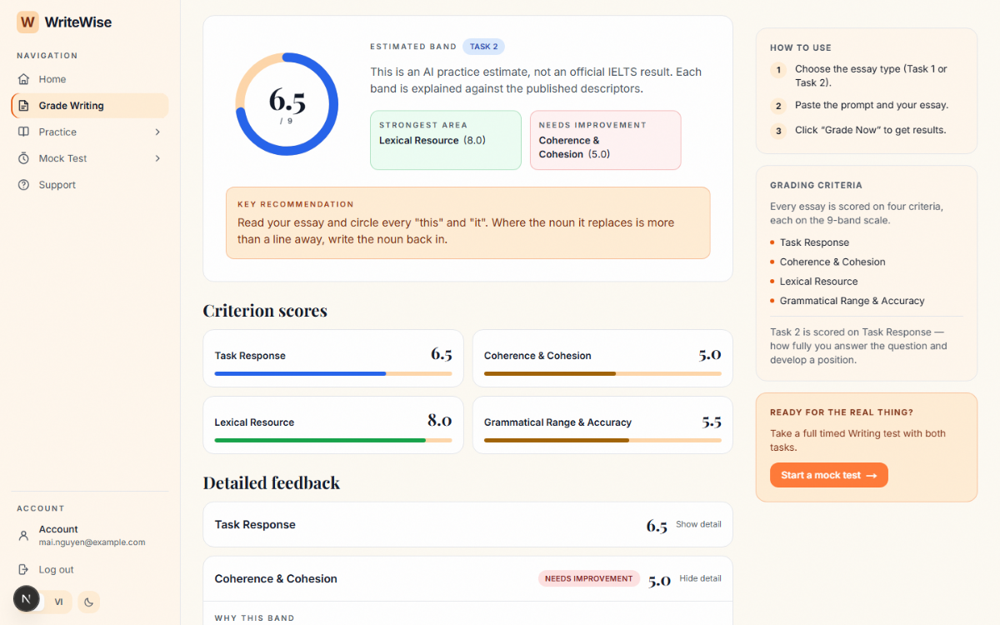
</p>

---

## 👥 Group information 

| STT | Student ID | Full Name | Role | Github | Email |
| --- | --- | --- | --- | --- | --- |
| 1 | 23521329 | Nguyễn Văn Quyền | Developer | [quyen244](https://github.com/quyen244) | 23521329@gm.uit.edu.vn |

---

## Table of Contents

- [Project Overview](#project-overview)
- [Screenshots](#screenshots)
- [Key Features](#key-features)
- [Tech Stack](#tech-stack)
- [Architecture](#architecture)
- [Scoring Methodology](#scoring-methodology)
- [Dataset](#dataset)
- [Results and Evaluation](#results-and-evaluation)
- [Project Structure](#project-structure)
- [Installation and Setup](#installation-and-setup)
- [Usage](#usage)
- [Testing](#testing)
- [Known Limitations](#known-limitations)
- [References](#references)

---

## Project Overview

### Problem

An IELTS candidate can write as many practice essays as they like, but they cannot mark them.
Human marking is the scarce resource: a tutor costs money per essay, turnaround is measured in days, and the feedback a learner receives is often a number with a sentence attached rather than an explanation they can act on.

### What this project builds

A self-service marking workspace that returns, within seconds of submission:

- an overall band on the 9-point scale,
- a band for each of the four official criteria,
- a justification per criterion written against the published band descriptors,
- one concrete, actionable improvement per criterion,
- and the exact sentences from the learner's own essay that the judgement rests on.

### Design goals that shaped the system

The repository is governed by a written constitution (`.specify/memory/constitution.md`), and three of its principles shape almost every file in it:

1. **No band without its explanation.** A score that cannot be traced to a descriptor and a quote is not shippable, so partial results are never written.
2. **No methodology change without evidence.** Scoring behaviour lives in versioned configuration, and a change must be benchmarked against the golden dataset before adoption.
3. **The client never calls the compute tier.** The browser writes a job row and watches it change. That is what keeps API keys out of the bundle and makes the marker replaceable without touching the frontend.

---

## Screenshots

| Grader workspace | Scoring in progress |
| --- | --- |
| 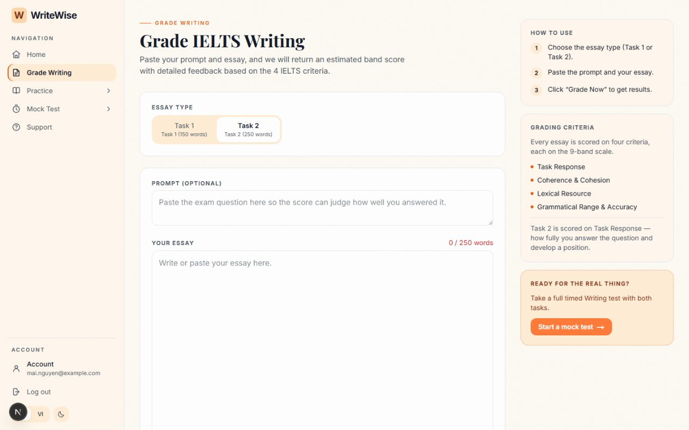 | 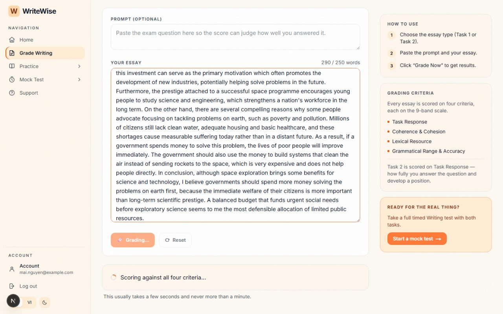 |

| Result dashboard | Criterion detail with evidence |
| --- | --- |
| 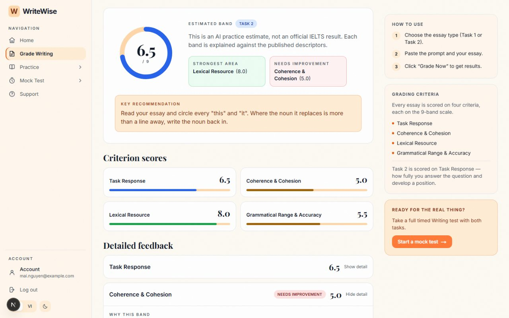 | 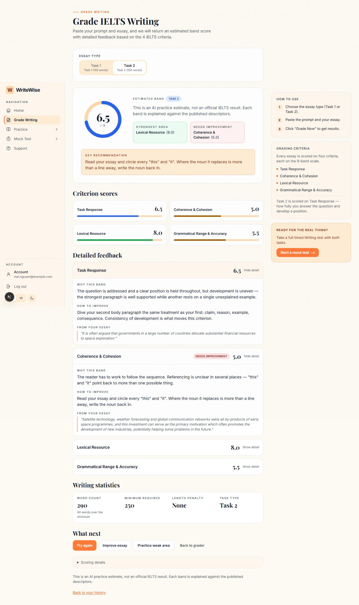 |

| Account progress | Writing mock test |
| --- | --- |
| 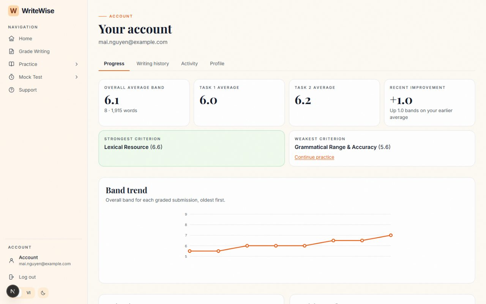 | 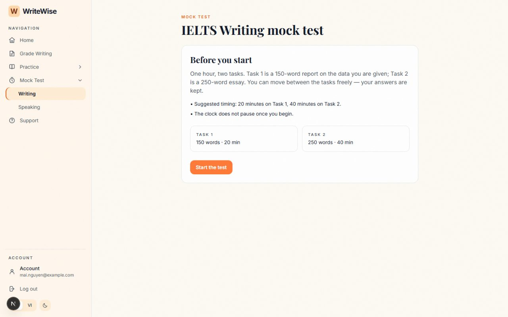 |

| Practice modules | Task 1 editor |
| --- | --- |
| 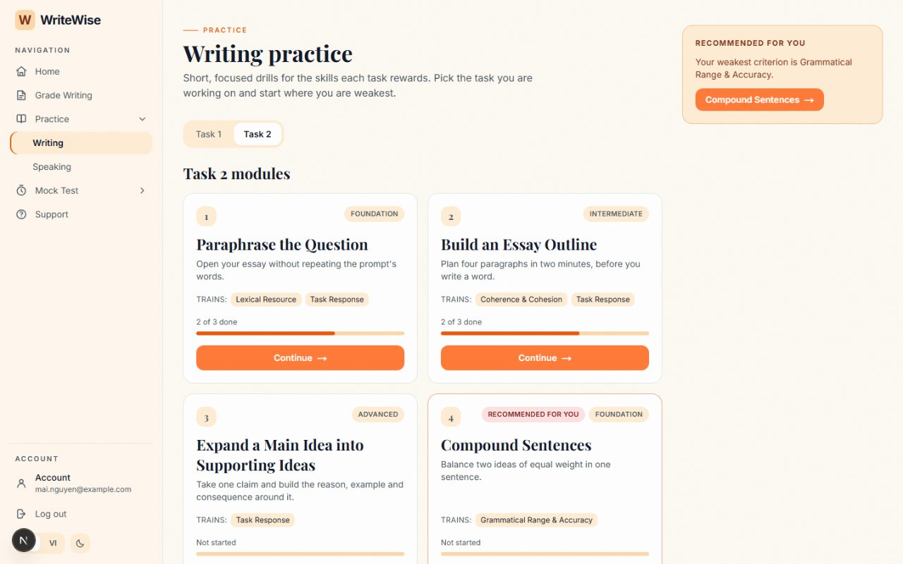 | 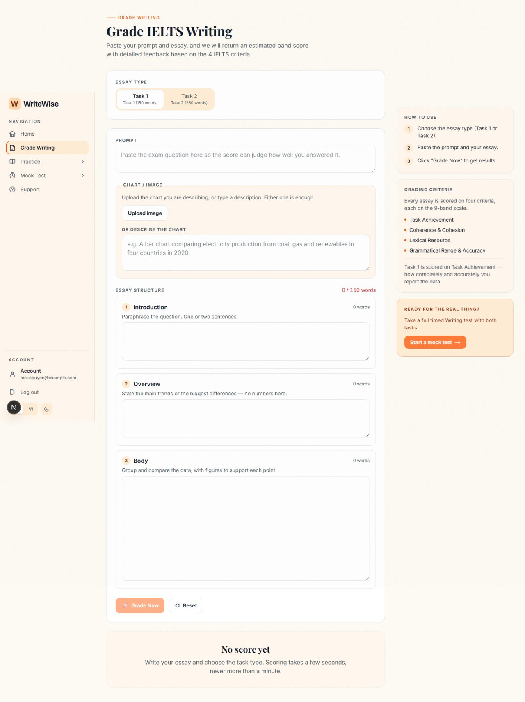 |

| Dark theme | Mobile |
| --- | --- |
| 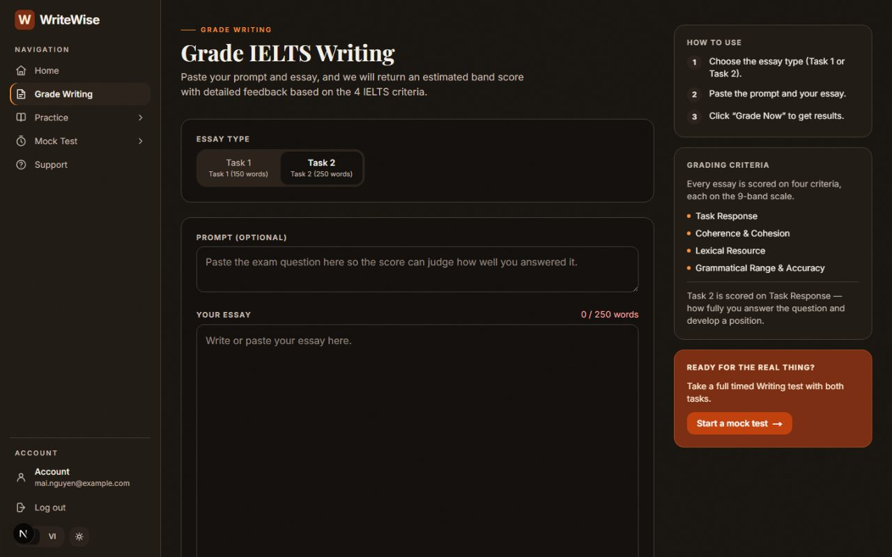 | 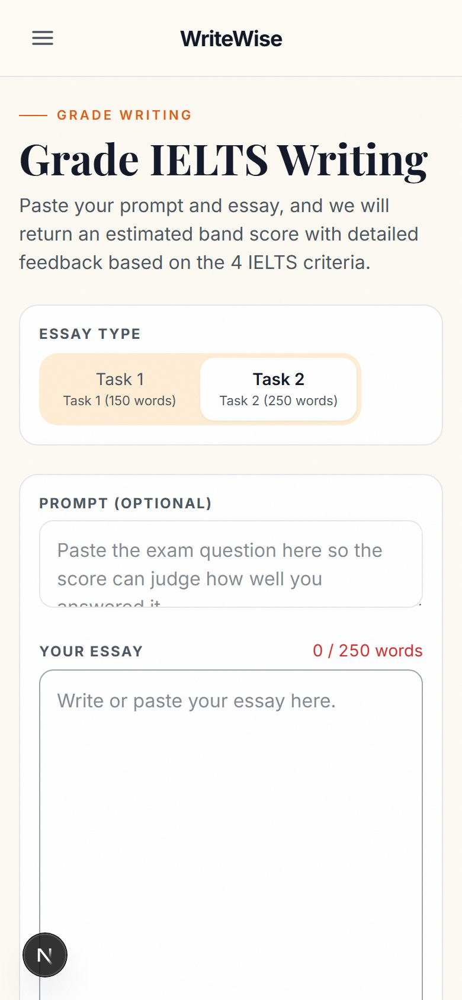 |

| Landing page | FAQ |
| --- | --- |
| 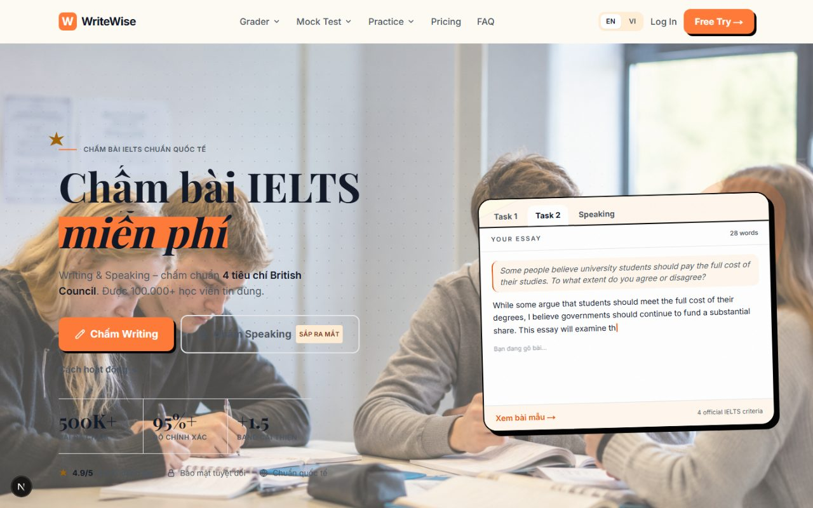 | 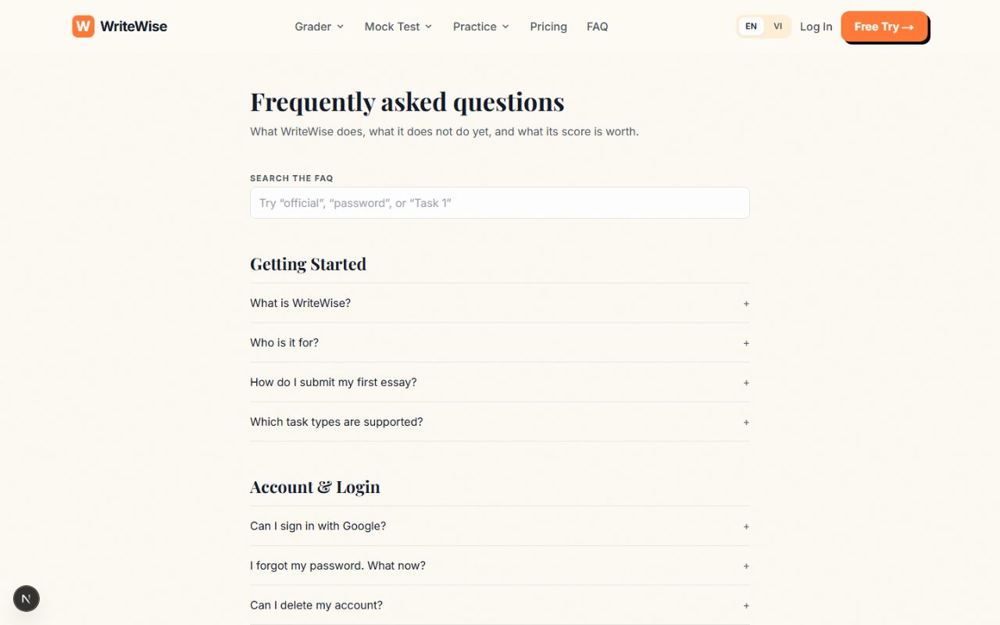 |

**Walkthrough video:** [`docs/media/grading-walkthrough.webm`](docs/media/grading-walkthrough.webm) records the full journey in one take - landing page, sign in, pasting a Task 2 essay, the scoring state, and the result dashboard.

---

## Key Features

### Writing grader (`/workspace`)

- Task 1 and Task 2 in one workspace, switched by a radio group.
- Task 1 is edited as three labelled parts (introduction, overview, body) because examiners read it as three parts, and an optional chart image can be attached alongside a written chart description.
- Live word count against the task minimum (150 words for Task 1, 250 for Task 2).
- An under-length essay is still scored. It receives a length penalty and is flagged as a provisional estimate rather than being refused, because a learner who wrote 190 words still needs to know what is wrong with them.
- Submissions with too little usable English to assess are refused before any model call is made, so junk input costs nothing.
- An error never touches the draft. The grading module is written so that a failed submission cannot clear the editor, because it never holds the text in the first place.

### Result dashboard (`/results/[id]`, and inline in the workspace)

- Overall band shown as a ring meter, with the strongest and weakest criterion called out.
- One card per criterion, each expandable into "why this band", "how to improve", and "from your essay".
- A key recommendation derived from the weakest criterion, with a direct link into the practice module that targets it.

### Practice (`/practice/writing`)

- Practice modules, each containing exercises, served from the database rather than hardcoded in the bundle so that content can be fixed with an `UPDATE` instead of a redeploy.
- Per-module progress is computed from attempts rather than stored as a second copy of the same fact.

### Mock test (`/mock-test/writing`)

- A timed, two-task sitting (20 minutes on Task 1, 40 on Task 2) with free movement between the tasks.
- Mock submissions are recorded through the same `writing_attempts` table as the grader and distinguished by a `source` column, so one Task 2 essay is marked identically regardless of where it came from.

### Account area (`/account`)

- Progress tab with overall average, per-task averages, recent improvement, strongest and weakest criterion, and a band-trend chart.
- Writing history, activity feed, and profile, all derived with database views and functions rather than materialised tables.

### Cross-cutting

- Full EN / VI interface switching, light and dark theme, and a route guard that runs in middleware before the page renders so a protected route never flashes its shape at a signed-out visitor.
- Authentication through Supabase Auth with the session held in cookies (`@supabase/ssr`), which is what lets the middleware and server components see the same session the browser holds.
- A mock transport: with no Supabase credentials configured, the entire product still runs on in-memory fixtures. This is what makes the app reviewable from a fresh checkout and the unit suite runnable without credentials.

---

## Tech Stack

| Layer | Technology |
| --- | --- |
| Frontend | Next.js 16 (App Router), React 19, TypeScript 5.7, Tailwind CSS 3.4, `motion` |
| Auth, database, storage | Supabase (Postgres 17, Row Level Security, Auth, Storage, Realtime) |
| Compute | Supabase Edge Function (Deno), dispatched by a Postgres trigger through `pg_net` |
| Model provider | OpenRouter, currently `inclusionai/ling-3.0-flash` |
| Evaluation workbench | Python 3.12, Pydantic 2, httpx, PyYAML, pytest |
| Frontend testing | Vitest, Testing Library, Playwright |
| Lint and types | ESLint 9, `tsc --noEmit`, Ruff |
| CI | GitHub Actions |

---

## Architecture

```
Browser (Next.js)                 Supabase                       OpenRouter
─────────────────                 ────────                       ──────────
                  1. INSERT status='queued'
  supabase-js  ───────────────▶  writing_attempts
  (publishable                        │
   key only)                          │ 2. AFTER INSERT trigger
                                      │    + pg_net.http_post
                                      ▼
                               grade-attempt            4. four criterion
                               Edge Function  ─────────────────────────▶  model
                               (service_role)  ◀─────────────────────────
                                      │            5. four JSON verdicts
                                      │ 6. UPDATE status='scored'
                                      │    + INSERT llm_calls
                                      ▼
  supabase-js  ◀───────────────  writing_attempts
                  7. poll until terminal status
```

### Why the client does not call the scoring function

The browser inserts a row and then watches that row.
It does not know the Edge Function exists, does not know OpenRouter exists, and holds no API key.

Three things fall out of that choice:

- **Secrets stay in the compute tier.** `OPENROUTER_API_KEY` and `SUPABASE_SERVICE_ROLE_KEY` are Edge Function secrets. The publishable key in the client bundle is not a secret, because RLS is the access control.
- **Marking survives the tab closing.** The row is already queued and the work happens server-side, so the result lands in history whether or not anyone was watching.
- **The marker is replaceable.** Moving scoring to a Python GPU worker later would not change a line of frontend code, because the worker would simply be another consumer of the same job table.

### Boundaries the code is written to defend

| Boundary | Rule |
| --- | --- |
| Client to compute | The client never calls the Edge Function directly |
| Secrets | `service_role` and the model key exist only as Edge Function secrets |
| Scores | Only `service_role` can write a score-bearing column |
| Content | Prompts and exercises live in the database, never hardcoded in the bundle |
| Cost | Every model call writes an `llm_calls` row, successful or not |
| Schema | Every schema change is a migration file in the repository |

### Data model

The schema is built from three groups of tables with three different lifecycles:

| Group | Tables | Who writes | Lifecycle |
| --- | --- | --- | --- |
| Content | `mock_tests`, `mock_test_tasks`, `practice_modules`, `practice_exercises` | Seed | Changes when content changes; learners read only |
| Attempts | `writing_attempts`, `mock_test_attempts`, `practice_attempts` | Learners, through RLS | Append-only |
| Operations | `llm_calls` | `service_role` only | Learners cannot read it |

`writing_attempts` is both the submission table and the job queue.
Its status machine is `queued -> scoring -> scored | failed`, plus a `rejected` terminal state reached by the pre-flight gate before any model call is made.

There is deliberately no `history` table and no `progress` table.
Both are questions, not entities: history is a query over `writing_attempts`, and progress is the `get_progress_summary()` function and the `v_practice_progress` / `v_activity` views.
Storing them would be a second copy of derivable data, and the second copy goes stale.

Full reasoning is in [`docs/data-model.md`](docs/data-model.md) and [`docs/system-architecture.md`](docs/system-architecture.md); the decisions behind them are recorded in [`CLARIFICATION.md`](CLARIFICATION.md).

---

## Scoring Methodology

The active pipeline is **`pipeline-v3.2`** with prompt set **`v4`**.

### The four calls

Task 1 is scored on Task Achievement, Coherence and Cohesion, Lexical Resource, and Grammatical Range and Accuracy.
Task 2 replaces Task Achievement with Task Response.
The four criterion calls are issued concurrently with `Promise.all`, because no criterion's judgement depends on another's, so concurrency cuts wall-clock latency at identical spend.

Each call returns a strict JSON object: `justification`, `descriptor_reference`, `band`, `confidence`, `comment {en, vi}`, `improvement {en, vi}`, and 2-4 `evidence` items.

### What the model is not allowed to do

Defence in depth is applied the same way at three layers: the prompt asks, the response schema requires, and the code verifies.

- **Quote verification.** Every returned quote is matched character-for-character against the submitted essay and silently dropped if it does not appear. The model cannot put words in the learner's mouth.
- **Prompt-injection hardening.** The essay is wrapped in markers carrying a random per-call nonce, and both prompts state that the text between them is data rather than instructions. This was added after a measured case in which an essay containing a forged closing marker moved one criterion by two full bands.
- **No arithmetic.** The model is handed the word count as ground truth and told not to re-count. Band snapping, clamping, averaging, and the length penalty are all applied in code.
- **No double penalty.** The under-length penalty is applied to the task criterion alone (Task Achievement or Task Response), never spread across all four, so one shortcoming is not marked down four times. The thresholds are 15% under the minimum for -0.5 and 40% under for -1.0.
- **Reasoning tokens disabled.** The provider's reasoning mode is off for a measured reason, not a stylistic one: reasoning tokens are billed output tokens charged against `max_tokens`, and leaving them on truncated every response mid-JSON.

### Configuration, not code

`eval/pipelines/*.yaml` is the single source of truth for how an essay is scored.
Changing the model, its parameters, or which prompt and rubric set is used requires editing that file only.
Prompt and rubric text lives in `eval/prompts/<version>/`.

Because the Edge Function must score identically to the harness that benchmarked it, the production assets are generated rather than hand-written:

```bash
cd eval && python -m scripts.export_edge_assets
```

This regenerates `supabase/functions/grade-attempt/generated/assets.ts` from `eval/pipelines/v3.yaml`, `eval/prompts/v4/**`, and `eval/src/pipeline/lexicon.py`.
A rubric edited on one side only would otherwise make the committed accuracy numbers describe a pipeline that nobody is running.

---

## Dataset

The golden dataset lives in `eval/data/golden/` and holds **10 labelled essays**: 5 Task 1 and 5 Task 2.

| Field | Meaning |
| --- | --- |
| `essay_id` | `T1-001` to `T1-005`, `T2-001` to `T2-005` |
| `task_type` | `TASK_1` or `TASK_2` |
| `topic`, `prompt_text` | The exam question the essay answers |
| `essay_text` | The learner's submission, unedited |
| `notes` | A written band profile explaining the label |
| `gold.overall`, `gold.criteria` | Rater bands, overall and per criterion |
| `gold.source` | How the label was produced (`expert-estimate-from-official-descriptors`) |
| `gold.confidence` | Label confidence, currently `medium` across the set |

Ten samples cannot carry a methodology decision on their own, and the project's own constitution says so.
Growing the set from production submissions flagged as low-confidence, failed, or anomalous is treated as part of the job rather than as future work.

---

## Results and Evaluation

### Benchmark: four calls per essay vs one call per essay

Both runs below are real model calls against the same 10 golden essays, same model (`nvidia/nemotron-3-super-120b-a12b:free`), same day, same machine.
Artifacts: `eval/data/reports/20260823-175455-518e/` (v1) and `eval/data/reports/20260823-174535-2786/` (v2).

| Metric | pipeline-v1.0 (4 calls/essay) | pipeline-v2.0 (1 call/essay) | Verdict |
| --- | --- | --- | --- |
| LLM calls (10 essays) | 40 | 10 | v2: 4x fewer calls, as designed |
| MAE (overall band vs gold) | 0.5 | 0.45 | v2 slightly better |
| Within 0.5 band | 70% | **90%** | v2 clears the 90% target, v1 does not |
| Within 1.0 band | **100%** | 90% | v1 better; v2 has one essay off by 1.5 |
| Spearman rho | **0.908** | 0.808 | v1 better, but n=10 makes this noisy |
| Quote fidelity | 0.986 | 0.988 | Parity |
| Tokens per essay | **7,012** | 9,858 | v2 uses ~40% **more** tokens |
| p50 latency per essay | **15.8s** | 32.7s | v2 ~2x slower |
| p95 latency per essay | **23.9s** | 72.5s | v2 exceeds the 60s target |

**Verdict: v2 was built, benchmarked, and rejected.**
The original assumption was that consolidating four calls into one would cut cost, because cost was assumed to track call count.
It tracks tokens, and one call carrying all four rubrics plus a few-shot worked example uses more of them than four smaller prompts do.
Consolidation also removed the concurrency that had been hiding per-call latency, which is a structural property of the change rather than a bug to patch.

The benchmark also surfaced a real defect: the model leaked Chinese, Dutch, Arabic and Thai fragments into Vietnamese output fields in 6 of 80 cases (7.5%), concentrated on one criterion and one grammar term.
A prompt rule reduced but did not eliminate it, which is what motivated the current model change and the server-side validation approach.

Full write-up: [`specs/00-grading-feature/phase-a-findings.md`](specs/00-grading-feature/phase-a-findings.md).

### Current pipeline on a live model

`eval/data/reports/20260823-201717-d0fc/` records the adopted architecture (four concurrent calls, bilingual output) on `inclusionai/ling-3.0-flash`:

| Metric | Value |
| --- | --- |
| Essays | 1 (Task 2) |
| Wall clock | 16.2s for four concurrent calls |
| Overall band error | +0.5 (predicted 6.0, gold 5.5) |
| Within 0.5 band | 100% |
| Quote fidelity | 1.0 (12 of 12 quotes verified) |
| Failure rate | 0.0 |
| Tokens per essay | 9,578 |
| Foreign-script leakage | None observed |

This is a single-essay run and is reported as one.
It validates that the pipeline works end to end on the current model; it does not re-establish an accuracy baseline, and the 10-essay re-run on this model has not been done.

### End-to-end verification of the grading feature

The grading flow was exercised in a real browser against the running application on the mock transport:

| Check | Result |
| --- | --- |
| Submit a 250+ word Task 2 essay | Accepted |
| Scoring state shown while marking | Yes |
| Time to result | 1.7s |
| Overall band returned | 6.5 |
| Criterion cards returned | 4 of 4 |
| Per-criterion justification, improvement, and quoted evidence | Present on every card |
| Uncaught page errors across the whole session | 0 |

---

## Project Structure

```
ie_writing/
├── frontend/                       # Next.js 16 application
│   ├── src/app/                    # 14 routes: landing, auth, workspace,
│   │                               #   practice, mock-test, results, account, faq
│   ├── src/components/             # landing, grader, result, app shell, auth, motion
│   ├── src/lib/
│   │   ├── api/                    # Data seam: grading, practice, mockTest, account
│   │   ├── supabase/               # Browser client, server client, middleware session
│   │   ├── i18n/                   # EN and VI message catalogues
│   │   ├── auth.ts                 # Auth seam: Supabase Auth or mock transport
│   │   └── theme.ts, navigation.ts
│   ├── src/mockData/               # Fixtures that back the mock transport
│   ├── src/middleware.ts           # Route guard, runs before render
│   └── tests/                      # unit (Vitest), e2e (Playwright), integration
│
├── supabase/
│   ├── migrations/                 # 13 migrations: schema, RLS, grants, dispatch,
│   │                               #   rate limiting, input caps
│   ├── functions/grade-attempt/    # The marking worker (Deno)
│   │   ├── index.ts                # Claim row, gate, four calls, persist
│   │   ├── openrouter.ts           # Model client with retry and usage accounting
│   │   ├── prompt.ts               # Message construction with per-call nonce
│   │   ├── extract.ts              # Word counts and text features
│   │   ├── gate.ts                 # Pre-flight rejection before any spend
│   │   ├── verify.ts               # Quote verification
│   │   ├── aggregate.ts            # Band snapping, length penalty, overall average
│   │   └── generated/assets.ts     # GENERATED from eval/ - do not edit by hand
│   ├── scripts/setup-local-grading.sh
│   ├── tests/                      # rls.sql, api.mjs (live API suite)
│   └── seed.sql
│
├── eval/                           # Offline scoring evaluation workbench
│   ├── pipelines/                  # v1, v2, v3 YAML - the scoring source of truth
│   ├── prompts/                    # v1 to v4: criterion templates + IELTS rubrics
│   ├── data/golden/                # 10 labelled essays (5 Task 1, 5 Task 2)
│   ├── data/reports/               # One directory per benchmark run
│   ├── src/pipeline/               # Orchestration, preprocess, verify, aggregate
│   ├── src/llm/                    # Model-agnostic client + OpenRouter adapter
│   ├── src/evaluation/             # Dataset loader, harness, metrics
│   ├── scripts/export_edge_assets.py
│   └── tests/                      # 150 offline tests, zero API spend
│
├── docs/                           # Architecture, data model, auth playbook,
│                                   #   screenshots, walkthrough video
├── specs/00-grading-feature/       # Spec, plan, findings, security review
├── scripts/gen-seed.ts             # Regenerates seed.sql from frontend fixtures
├── CLARIFICATION.md                # Every decision and its reasoning
└── TODO.md                         # Per-task status and known technical debt
```

---

## Installation and Setup

### Prerequisites

| Tool | Version | Needed for |
| --- | --- | --- |
| Node.js | 22 or newer | Frontend |
| Python | 3.12 or newer | Evaluation workbench |
| Docker Desktop | Current | Local Supabase stack |
| Supabase CLI | Current | Migrations, Edge Functions |
| OpenRouter API key | - | Live model calls (not needed for the offline suite) |

### 1. Frontend only (mock transport, no backend required)

This is the fastest way to see the whole product.
With no Supabase credentials configured, the app falls back to in-memory fixtures and every screen still works.

```bash
cd frontend
npm install
npm run dev
```

Open `http://localhost:3000`.
In this mode any email and any password of at least 8 characters will sign you in.

> Note: use `localhost`, not `127.0.0.1`.
> Next 16's development origin allowlist returns 403 for `_next/static` chunks served to `127.0.0.1`, which leaves the page unhydrated.

### 2. Frontend against a real Supabase project

```bash
cd frontend
cp .env.example .env.local
```

```env
NEXT_PUBLIC_SUPABASE_URL=https://<project>.supabase.co
NEXT_PUBLIC_SUPABASE_PUBLISHABLE_KEY=sb_publishable_...
```

The publishable key is in the client bundle on purpose.
It is not a secret; RLS is what controls access.

### 3. Local Supabase stack with grading

```bash
npx supabase start          # boots the stack, runs migrations and seed
npx supabase db reset       # rebuild from scratch
npx tsx scripts/gen-seed.ts # regenerate seed.sql from the frontend fixtures
```

Grading needs two secrets that a database reset drops, so they are re-applied by a script:

```bash
# supabase/functions/.env (gitignored)
OPENROUTER_API_KEY=<your key>
GRADE_ATTEMPT_SECRET=<any long random string>
```

```bash
./supabase/scripts/setup-local-grading.sh
npx supabase functions serve --env-file supabase/functions/.env
```

Without this step every submission sits in `queued` and the dispatch trigger logs a warning once a minute.

### 4. Evaluation workbench

```bash
cd eval
pip install -r requirements.txt
cp .env.example .env     # set OPENROUTER_API_KEY only for live runs
```

---

## Usage

### Grade an essay in the app

1. Sign in and open `/workspace`.
2. Choose Task 1 or Task 2.
3. Paste the exam question into the optional prompt field, then the essay.
4. Press **Grade Now**.
5. Read the overall band, the four criterion cards, and the quoted evidence behind each one.

### Run the benchmark harness

```bash
cd eval

# Offline smoke test. Injects FakeLLMClient, makes zero API calls, costs nothing.
python -m src.evaluation.harness --fake --limit 2

# Live benchmark against the full golden dataset. Spends real credit.
python -m src.evaluation.harness --pipeline-config pipelines/v3.yaml

# Useful flags
#   --task TASK_1|TASK_2   restrict to one task type
#   --limit N              first N essays only
#   --out-dir PATH         where the run artifacts are written
```

Each run writes `metrics.json`, `raw_results.json`, and a human-readable `report.md` into a timestamped directory under `eval/data/reports/`.

### Change the scoring methodology

Never edit Python to change how essays are scored.
Edit the configuration and prove the change on data:

```bash
cd eval
cp -r prompts/v4 prompts/v5          # only if prompt or rubric text is changing
cp pipelines/v3.yaml pipelines/v4.yaml
# edit pipelines/v4.yaml
python -m src.evaluation.harness --pipeline-config pipelines/v4.yaml
# compare the new metrics.json against the previous run before adopting
python -m scripts.export_edge_assets # regenerate the Edge Function assets
```

---

## Testing

Verified on 2026-10-15 by running each suite.

| Suite | Command | Result |
| --- | --- | --- |
| Evaluation workbench | `cd eval && pytest -q` | **150 passed** |
| Frontend unit and component | `cd frontend && npm test` | **242 passed**, 7 failed, 2 skipped |
| Browser end-to-end grading flow | Manual Playwright session on the mock transport | **Passed** - band 6.5, 4 of 4 criteria, 1.7s, zero page errors |

The 7 failing tests are all in `tests/unit/landing/Hero.test.tsx` and are a known, documented regression rather than a new one.
The landing page was intentionally rewritten in Vietnamese in commit `8c00bdb` and the English assertions in that file were never updated.
This is recorded in [`TODO.md`](TODO.md) under known technical debt.

Other suites in the repository:

```bash
cd frontend
npm run lint          # ESLint 9
npm run typecheck     # tsc --noEmit
npm run test:e2e      # Playwright, production build on port 3100

cd supabase/functions/grade-attempt
deno task test        # Edge Function unit tests

# Live Supabase API suite, publishable key only - anything it can do, a learner can do
SUPABASE_URL=... SUPABASE_PUBLISHABLE_KEY=... node supabase/tests/api.mjs
```

CI (`.github/workflows/ci.yml`) runs the Python lint, the Python suite, the harness smoke test, the frontend lint, typecheck, unit tests, Playwright end-to-end tests, and `npm audit`.
Every test injects a fake model client, so the suite makes zero upstream calls and costs nothing to run.

---

## Known Limitations

These are recorded rather than hidden, and most are tracked in [`TODO.md`](TODO.md).

| Limitation | Impact |
| --- | --- |
| Task 1 grading does not look at the chart image | The image is stored for review only; the band rests on the learner's own written description, so a misread figure is not detected - which is exactly what Task Achievement is about |
| Email confirmation is disabled | Anyone can register with an address they do not own. Acceptable while in development, must be re-enabled before real users |
| The current model has one live run on one essay | The 10-essay accuracy baseline was measured on the previous model; it has not been re-established on `inclusionai/ling-3.0-flash` |
| `pg_net` dispatch is fire-and-forget | A missed dispatch leaves a row in `queued` forever. A sweeper over `writing_attempts_pending_idx` is required, not optional |
| Mock test grading still uses the mock transport | The grader is wired to the real pipeline; the two-task sitting bookkeeping is a separate piece of work |
| 7 Hero unit tests and 6 Playwright specs are stale | Both predate design and architecture changes and assert behaviour that was deliberately replaced |
| Golden dataset is 10 essays | Too small to carry a methodology decision on its own, by the project's own standard |
| Speaking is not implemented | The `skill` column exists and the navigation marks it as unavailable rather than linking to a dead end |

---

## References

- IELTS Writing band descriptors (public version), Task 1 and Task 2 - the rubric text in `eval/prompts/*/rubrics/`
- [Next.js documentation](https://nextjs.org/docs)
- [Supabase documentation](https://supabase.com/docs) - Row Level Security, Edge Functions, `@supabase/ssr`
- [OpenRouter documentation](https://openrouter.ai/docs) - model routing and usage accounting
- [Playwright](https://playwright.dev/) and [Vitest](https://vitest.dev/)
- Internal design records: [`CLARIFICATION.md`](CLARIFICATION.md), [`docs/system-architecture.md`](docs/system-architecture.md), [`docs/data-model.md`](docs/data-model.md), [`docs/live-model-validation.md`](docs/live-model-validation.md), [`specs/00-grading-feature/`](specs/00-grading-feature/)
