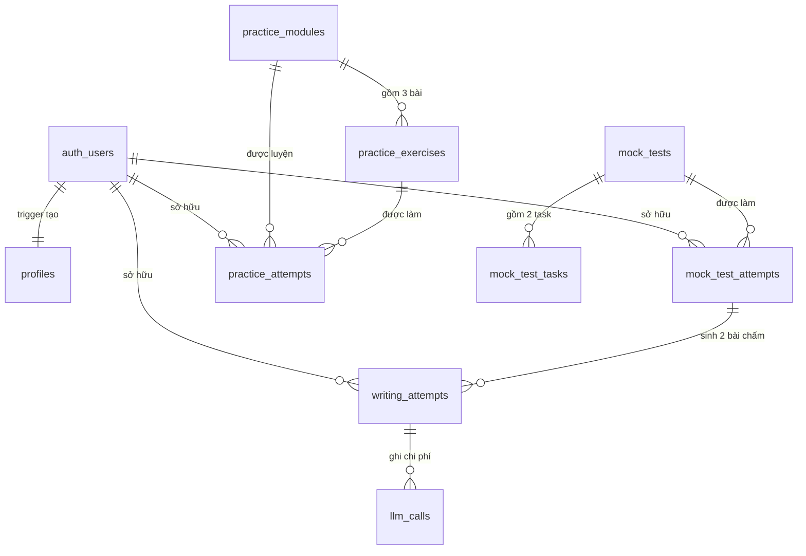
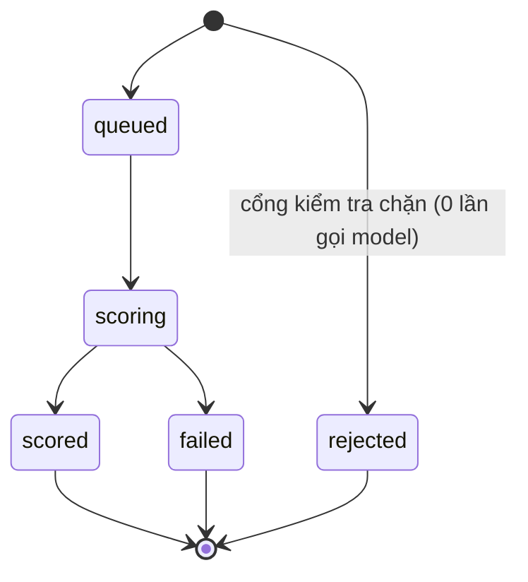

# Data model — WriteWise on Supabase

Nguồn sự thật là các file trong [`supabase/migrations/`](../supabase/migrations/). Tài liệu này
giải thích **vì sao** schema có hình dạng đó; khi hai bên lệch nhau, migration đúng.

Quyết định đằng sau từng lựa chọn nằm ở [CLARIFICATION.md](../CLARIFICATION.md).

```bash
npx supabase start        # dựng local, tự chạy migrations + seed
npx supabase db reset     # dựng lại từ đầu
npx supabase db push      # đẩy lên project cloud
npx tsx scripts/gen-seed.ts   # sinh lại seed.sql từ fixtures của frontend
```

---

## Ba nguyên tắc

### 1. Ba nhóm bảng, ba vòng đời

| Nhóm | Bảng | Ai ghi | Vòng đời |
|---|---|---|---|
| **Nội dung** | `mock_tests`, `mock_test_tasks`, `practice_modules`, `practice_exercises` | Seed | Đổi khi thêm đề. Học viên chỉ đọc |
| **Bài làm** | `writing_attempts`, `mock_test_attempts`, `practice_attempts` | Học viên, qua RLS | Sinh liên tục, không sửa lại |
| **Vận hành** | `llm_calls` | Chỉ `service_role` | Học viên không đọc được |

Nội dung nằm ở DB chứ không hardcode trong bundle: sửa một lỗi chính tả trong đề là `UPDATE`,
không phải deploy lại frontend.

### 2. Cái gì suy ra được thì không lưu

Không có bảng `history`, không có bảng `progress`. Cả hai là **câu hỏi**, không phải thực thể:

- Lịch sử = `select … from writing_attempts where user_id = auth.uid() and status = 'scored'`
- Progress = hàm `get_progress_summary()`
- Tiến độ practice = view `v_practice_progress`
- Dòng hoạt động = view `v_activity`

Lưu thành bảng tức là giữ bản sao thứ hai của dữ liệu suy ra được, và bản sao sẽ cũ. Đó là cách
một dashboard đi đến chỗ báo trung bình 6.5 phía trên danh sách bài trung bình 6.8.

### 3. Học viên không ghi được điểm của mình

Đây là nửa quan trọng nhất của schema. `writing_attempts` **không cấp `UPDATE` cho vai trò
`authenticated` trên bất kỳ cột nào**. Học viên `INSERT` bài của mình, `SELECT` kết quả của mình,
`DELETE` bài của mình — hết. Mọi cột mang điểm (`status`, `overall_band`, `criteria`,
`length_penalty`, `error_code`, `pipeline_version`, `model_id`) chỉ `service_role` ghi được.

Thiếu bước này thì bất kỳ ai cũng tự cấp band 9.0 cho mình bằng một lệnh REST, và luận điểm trung
tâm của sản phẩm thành vô nghĩa. Chấm lại một bài hỏng là **tạo row mới**, nên không có thao tác
hợp lệ nào cần `UPDATE`.

---

## Sơ đồ



---

## `writing_attempts` — bảng trung tâm

Vừa là bảng bài làm, vừa là **bảng job**. Frontend ghi row `status = 'queued'` rồi theo dõi row
đó đổi; nó không bao giờ gọi compute endpoint (constitution Principle VIII).

Grader và mock test dùng **chung** bảng này, phân biệt bằng `source`. Một bài Task 2 được chấm y
hệt nhau dù đến từ workspace hay từ phòng thi — tách bảng nghĩa là hai pipeline và hai màn hình
kết quả phải giữ cho khớp nhau mãi mãi.

### Máy trạng thái



Chỉ có chiều tiến. Chấm lại = row mới, không sửa row cũ. Chính điều này làm cho *"mở lại kết quả
cũ thì thấy đúng cái đã thấy lần đầu"* đúng theo cấu trúc, không cần cơ chế versioning.

### Ràng buộc do database ép, không phải do code tự giác

| Constraint | Ép điều gì |
|---|---|
| `scored_rows_are_complete` | Row `'scored'` phải có đủ band, criteria, pipeline_version, model_id, scored_at. Kết quả thiếu là **lỗi database** |
| `criteria_shape` | Đúng 4 tiêu chí, đúng mã cho task đó, đúng thứ tự, band trên lưới nửa bậc, **nhận xét có cả EN và VI** |
| `error_code_only_on_failure` | Chỉ hai trạng thái hỏng mới mang lý do |
| `mock_rows_belong_to_a_sitting` | `source='mock_test'` ⟺ có `mock_attempt_id` |
| `task1_parts_only_on_task1` | Ba phần và ảnh chỉ thuộc về Task 1 |

Ràng buộc thứ hai đáng chú ý: nó bắt buộc **song ngữ ở tầng dữ liệu**. Một kết quả chỉ có một thứ
tiếng sẽ hiện panel trống ngay khi học viên đổi ngôn ngữ, nên database từ chối lưu nó.

### Chỗ dành sẵn cho Speaking

Cột `skill` (`'writing'` | `'speaking'`) tồn tại từ bây giờ dù chưa dùng. Constitution yêu cầu
thêm Speaking **không được** buộc migrate dữ liệu attempt đang có.

### Task 1 lưu ba phần

`task1_introduction` / `task1_overview` / `task1_body` là ba cột riêng vì giám khảo chấm ba phần
riêng và frontend đếm từ riêng từng phần. `essay_text` giữ bản nối — thứ mà số từ và model nhìn
thấy — nên đọc lịch sử không phải nối lại.

### Ảnh biểu đồ

`chart_image_path` trỏ vào bucket **private** `chart-images`, đường dẫn `{user_id}/{file}`.
Hiển thị lại bằng signed URL.

> **Giới hạn đã biết, có chủ đích:** ảnh **không** được gửi cho model. Điểm dựa trên
> `chart_description` học viên tự gõ. Nghĩa là học viên mô tả sai số liệu thì hệ thống không phát
> hiện được — mà "báo cáo đúng số liệu" chính là nội dung của Task Achievement. Ghi trong
> [TODO.md](../TODO.md).

---

## Bảng còn lại

| Bảng | Ghi chú |
|---|---|
| `profiles` | `id` = `auth.users.id`. Tạo bằng trigger `on_auth_user_created`, không phải client insert — client insert là một tab đóng giữa chừng khỏi việc sinh ra tài khoản không có profile. Chủ sở hữu sửa được `full_name`, `locale`, `target_band`; **không** sửa được `email` (bản gốc thuộc `auth.users`) |
| `mock_tests` / `mock_test_tasks` | `unique (test_id, task_type)` — một đề có đúng một Task 1 và một Task 2 |
| `mock_test_attempts` | `combined_band` do trigger tính khi **cả hai** task chấm xong: Task 1 ×1, Task 2 ×2, chia 3, làm tròn nửa bậc. Thí sinh cấp quyền ghi `submitted_at` nhưng không ghi `status` — trigger giữ hai thứ khớp nhau |
| `practice_modules` / `practice_exercises` | `trains` là mảng mã tiêu chí; đây là field làm cho handoff "luyện điểm yếu" trỏ đúng bài. Sai giá trị ở đây gửi học viên đến bài sai, tệ hơn là không gợi ý gì |
| `practice_attempts` | Có `SELECT`/`INSERT`/`DELETE`, **không có `UPDATE`** — sửa câu trả lời sau khi xem bài mẫu biến lịch sử luyện tập thành hư cấu |
| `llm_calls` | RLS bật, **không policy nào** → không ai đọc được bằng user token. Có `reasoning_tokens` riêng vì với model hiện tại chúng là output token và từng làm hỏng mọi tiêu chí (`docs/live-model-validation.md`) |

---

## Ai đọc được gì

| Bảng | anon | authenticated | service_role |
|---|---|---|---|
| `profiles` | — | đọc/sửa row của mình (trừ `email`) | tất cả |
| `mock_tests`, `mock_test_tasks` | — | đọc đề đang bật | tất cả |
| `practice_modules`, `practice_exercises` | — | đọc module đang bật | tất cả |
| `mock_test_attempts` | — | đọc/tạo/kết thúc lượt của mình | tất cả |
| `practice_attempts` | — | đọc/tạo/xoá của mình | tất cả |
| `writing_attempts` | — | đọc/nộp/xoá của mình. **Không `UPDATE`** | tất cả |
| `llm_calls` | — | **không gì cả** | tất cả |
| Storage `chart-images` | — | đọc/ghi/xoá trong thư mục `{uid}/` | tất cả |

Mọi view đều `security_invoker = true`, nên RLS của người gọi vẫn áp dụng — view không phải cửa
hậu vòng qua policy.

---

## Khớp với frontend

Schema dựng được đúng các shape trong [`types.ts`](../frontend/src/lib/api/types.ts):

| Shape của frontend | Đến từ |
|---|---|
| `GradingResult` | Một row `writing_attempts` |
| `MockTest`, `MockTestTask` | `mock_tests` + `mock_test_tasks` |
| `MockTestResult` | `mock_test_attempts` + 2 row `writing_attempts` |
| `PracticeModuleSummary`, `PracticeModuleDetail` | `practice_modules` + `practice_exercises` + `v_practice_progress` |
| `HistoryEntry` | Truy vấn `writing_attempts` |
| `ProgressSummary` | `get_progress_summary()` |
| `ActivityEntry` | `v_activity` |

**Một chỗ frontend phải đổi:** mã tiêu chí. Database dùng `GRAMMATICAL_RANGE_ACCURACY` (theo
`eval/` và `specs/001`, tên chuẩn IELTS); frontend đang dùng `GRAMMATICAL_RANGE`. Đổi ở frontend
rẻ hơn đổi ở prompt và bộ đề chuẩn. Việc này nằm trong [TODO.md](../TODO.md).

---

## Chưa làm

- **Chưa có dispatcher.** Row nằm ở `queued` và không ai nhặt — Edge Function chấm bài thuộc phần
  đã hoãn có chủ đích. Index `writing_attempts_pending_idx` đã dựng sẵn cho cả dispatcher lẫn cron
  dọn row kẹt.
- **Chưa có rate limit.** Constitution Principle V yêu cầu, nhưng chỉ có ý nghĩa khi đã có lần gọi
  trả phí đầu tiên.
- **Chưa có test RLS.** Đây là món nợ nghiêm túc nhất trong danh sách này: constitution Principle
  III xếp test policy vào điều kiện "xong".
