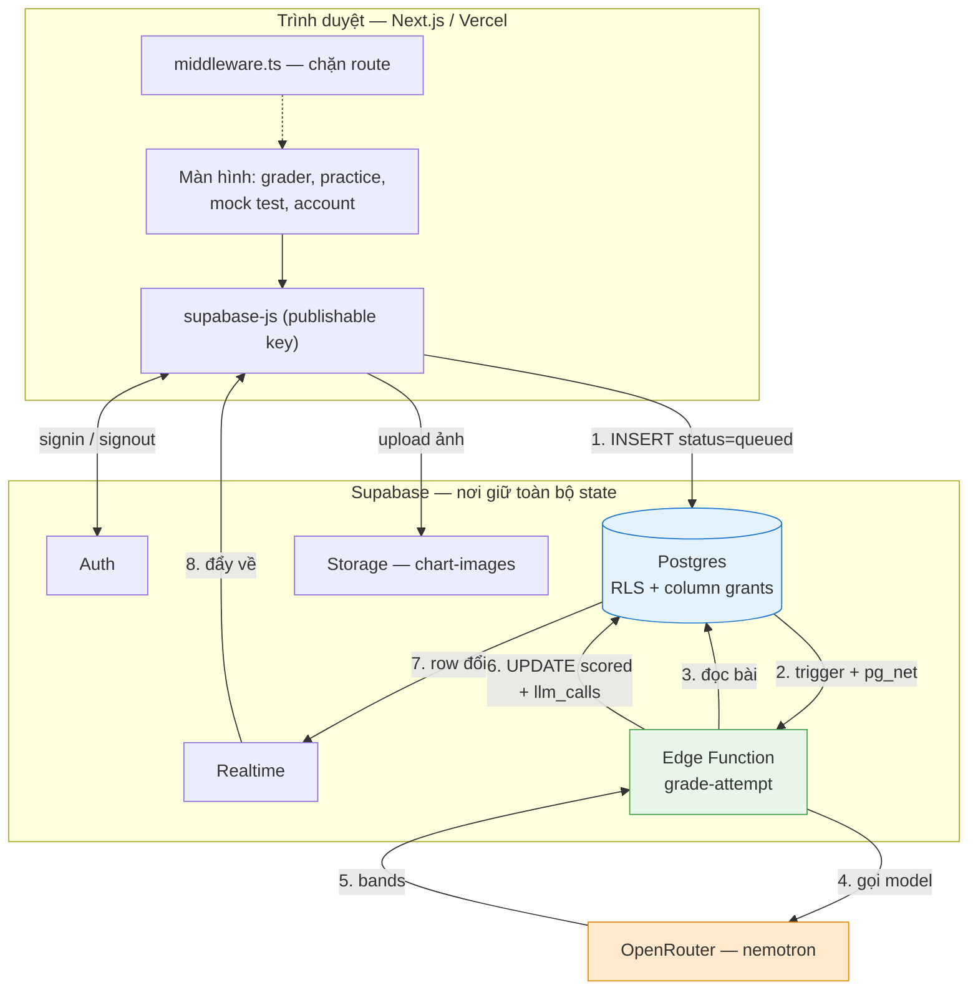
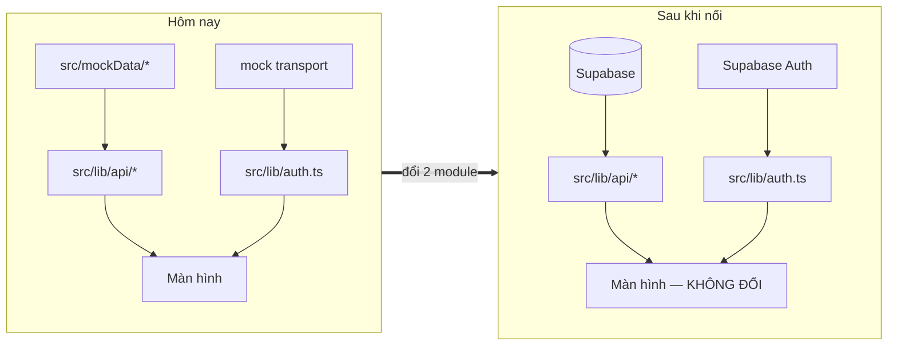
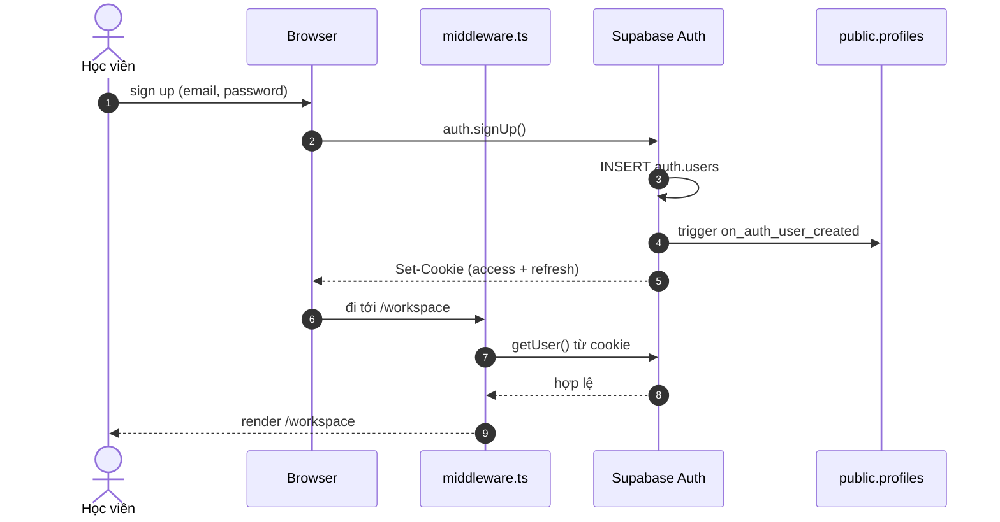
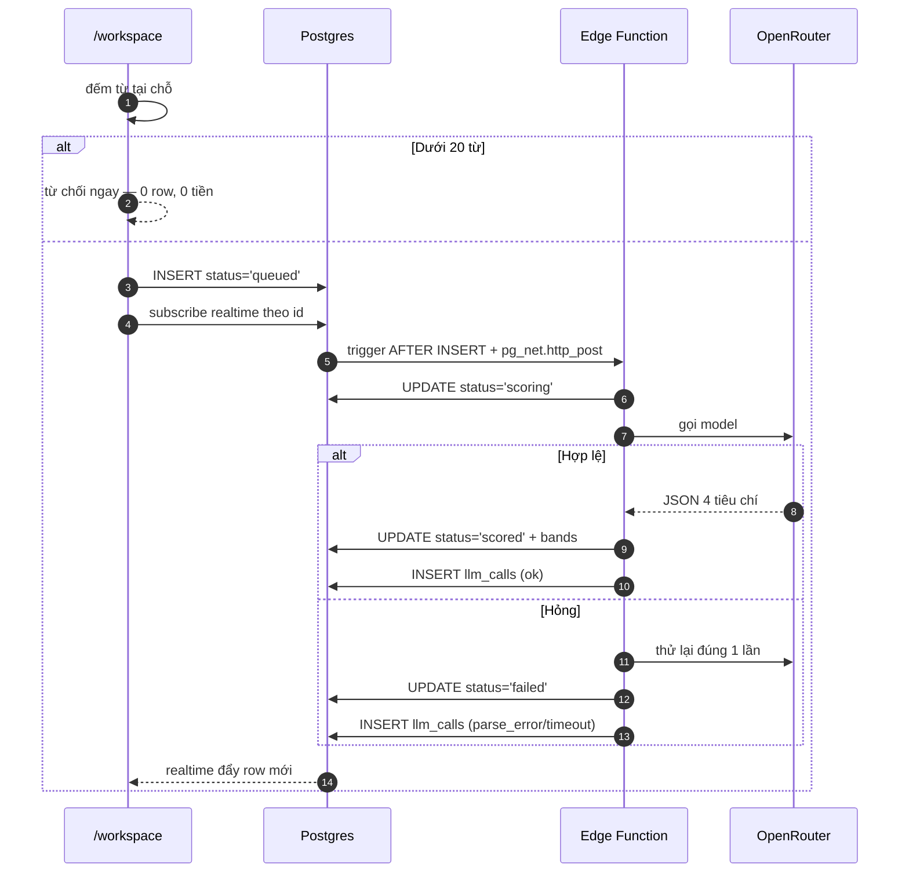

# System architecture — WriteWise

Tài liệu này trả lời câu hỏi *"tôi đang làm gì và cần làm gì"*. Nó mô tả hình dạng hệ thống khi
hoàn chỉnh, và đánh dấu rõ phần nào **đã dựng**, phần nào **chưa**.

Quyết định đằng sau từng lựa chọn: [CLARIFICATION.md](../CLARIFICATION.md). Chi tiết schema:
[data-model.md](./data-model.md). Trạng thái từng đầu việc: [TODO.md](../TODO.md).

---

## 1. Toàn cảnh

**Mũi tên 1 và 8 là điều đáng nhớ nhất.** Frontend chỉ `INSERT` một row rồi ngồi nghe row đó đổi.
Nó không biết Edge Function tồn tại, không biết OpenRouter tồn tại, không giữ API key nào.

Ngày nào việc chấm cần chuyển sang worker Python có GPU, **frontend không sửa một dòng** — worker
mới chỉ là một kẻ tiêu thụ khác của cùng bảng job. Đó là lý do constitution đặt Principle VIII là
NON-NEGOTIABLE, và là lý do phương án "gọi thẳng Edge Function" bị loại dù đơn giản hơn.

---

## 2. Ba seam ở phía frontend

Frontend đã được dựng quanh ba ranh giới. Chuyển từ mock sang Supabase là thay ruột ba chỗ đó,
không phải viết lại màn hình.

| Seam | File | Đổi gì khi nối thật |
|---|---|---|
| Dữ liệu | `src/lib/api/*` | Bỏ store in-memory, gọi `supabase.from(...)`. Chữ ký hàm giữ nguyên |
| Xác thực | `src/lib/auth.ts` | Bỏ mock transport, gọi Supabase Auth. Giữ nguyên 5 hàm và bộ mã lỗi |
| Điều hướng | `src/lib/navigation.ts` | Không đổi |

Giữ nguyên chữ ký hàm không phải là chuyện thẩm mỹ: nó là thứ khiến hơn 240 unit test hiện có
vẫn còn giá trị sau khi đổi transport.

---

## 3. Luồng xác thực — **đã dựng**

Xác thực email **tắt** — sign up xong là có phiên ngay. Phiên nằm trong **cookie** (`@supabase/ssr`),
không phải memory, nên middleware biết câu trả lời trước khi trang render và F5 không nháy màn hình.

> Đánh đổi đã ghi nhận: tắt confirm email nghĩa là ai cũng đăng ký được bằng email không có thật.
> Chấp nhận ở giai đoạn này, phải bật lại trước khi mở cho người dùng thật.

---

## 4. Luồng chấm bài — **thiết kế xong, chưa dựng**

Row `queued` hiện **nằm im, không ai nhặt**. Dispatcher và Edge Function thuộc phần đã hoãn có chủ
đích để bàn riêng. Schema và index đã chuẩn bị sẵn cho nó.

`llm_calls` ghi ở **cả hai nhánh**: một lần gọi thất bại vẫn là một lần gọi mất tiền.

**`pg_net` là bắn-rồi-quên.** Nếu lần gọi hụt, row kẹt ở `queued` vĩnh viễn. Bắt buộc phải có
thêm một cron quét index `writing_attempts_pending_idx` để dọn. Đây không phải tuỳ chọn.

---

## 5. Ranh giới không được vượt

| Ranh giới | Quy tắc | Vi phạm sẽ thế nào |
|---|---|---|
| Client ↔ compute | Client không bao giờ gọi Edge Function trực tiếp | Mỗi tính năng mới lại là một endpoint, một CORS, một chỗ giữ secret |
| Secret | `service_role` + `OPENROUTER_API_KEY` chỉ nằm trong secret của Edge Function | Lộ key = ai cũng chấm bài bằng tiền của bạn |
| Điểm số | Chỉ `service_role` ghi được cột điểm | Học viên tự cho mình band 9.0 |
| Nội dung | Đề và bài tập ở DB, không hardcode | Sửa lỗi chính tả trong đề phải deploy lại |
| Chi phí | Mọi lần gọi model đều có row `llm_calls` | Không ai biết tháng này tốn bao nhiêu, vì sao |
| Schema | Mọi thay đổi là file migration trong repo | Sửa qua dashboard không tái lập được |

---

## 6. Môi trường và secret

| Nơi | Giữ gì | Ai thấy |
|---|---|---|
| `frontend/.env.local` | `NEXT_PUBLIC_SUPABASE_URL`, `NEXT_PUBLIC_SUPABASE_PUBLISHABLE_KEY` | Bundle client — **cố ý**. Publishable key không phải secret; RLS mới là cơ chế kiểm soát |
| Secret của Edge Function | `OPENROUTER_API_KEY`, `SUPABASE_SERVICE_ROLE_KEY` | Chỉ compute tier. Nạp bằng `supabase secrets set` |
| `.env` gốc repo | Key dùng cho workbench `eval/` | Chỉ máy local. Đã có trong `.gitignore` |

Project Supabase hiện tại (`tmwozpzntzyupxrmgsro`) là **môi trường nháp** — migration được phép
`DROP` bảng ở đó. Trước khi tách prod thì đây là nơi duy nhất.

---

## 7. Đang ở đâu

| Thành phần | Trạng thái |
|---|---|
| Frontend 14 route, i18n EN/VI, dark mode | ✅ Xong, chạy trên mock data |
| Schema + RLS + column grants + seed | ✅ Migration đã viết, cú pháp đã kiểm |
| Chạy thử migration trên Postgres thật | 🚧 Chặn — Docker Desktop chưa bật |
| Auth thật qua Supabase | 🔨 Đang làm |
| `lib/api` nối vào Supabase | 📋 Cần làm |
| Edge Function chấm bài + dispatcher | ❄️ Hoãn — bàn riêng |
| Test RLS | 📋 Cần làm — constitution Principle III xếp vào điều kiện "xong" |
| Speaking | ❄️ Tương lai. Cột `skill` đã chừa sẵn |

Chi tiết từng đầu việc: [TODO.md](../TODO.md).
