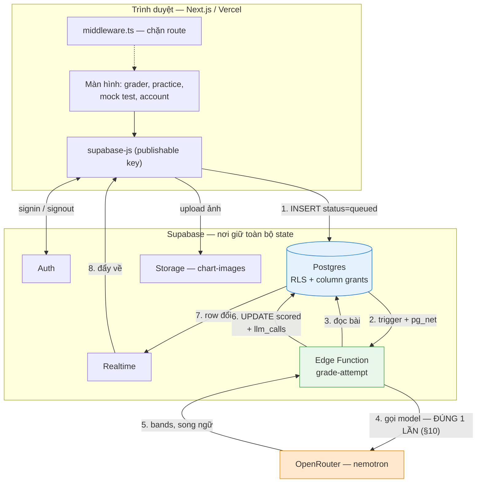
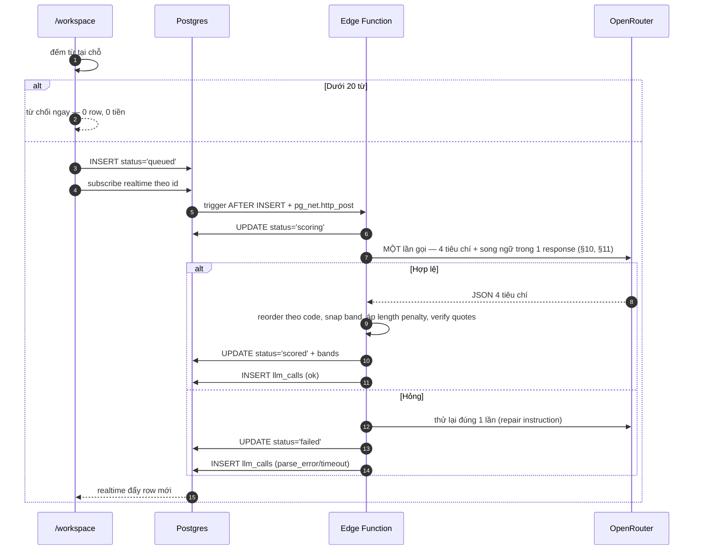
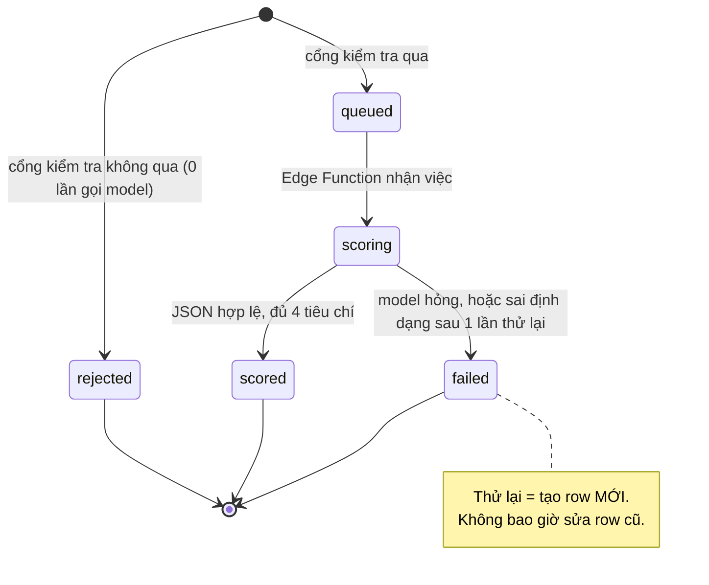
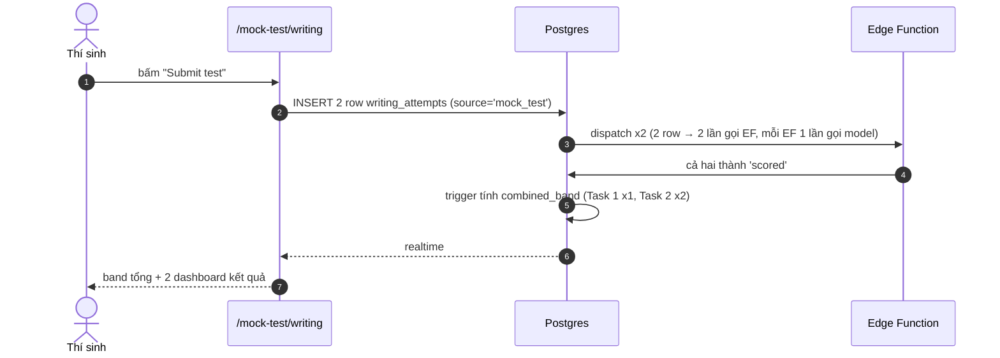
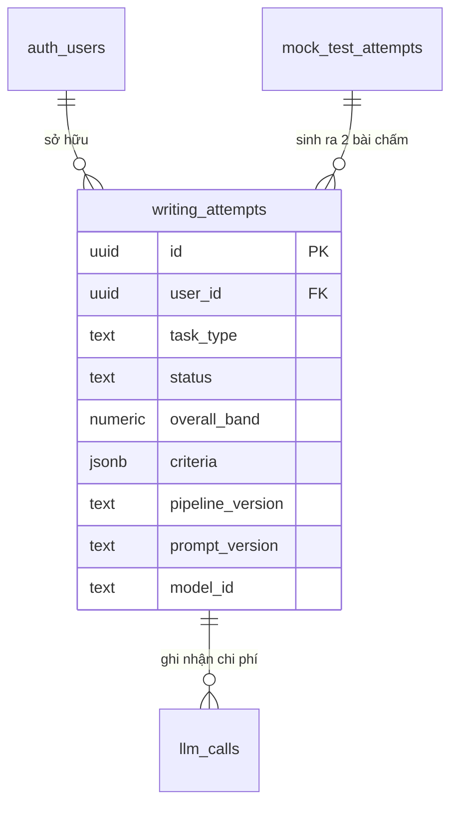

# Feature Specification: IELTS Grading Pipeline — Single-Call (pipeline-v2.0)

**Feature Branch**: `00-grading-feature` (not yet created)

**Created**: 2026-08-23

**Status**: Phase A built and benchmarked (2026-08-23) — see
[phase-a-findings.md](./phase-a-findings.md). Phase B (Edge Function) not started, awaiting
your review of Phase A's results.

**Input**: *"điều tôi muốn hiện tại cho pipeline mới là, một prompt, 1 llm call thay vì pipeline
tới 4 llm calls. Prompt như cũ nhưng nhét tất cả vào 1 prompt và có thêm few-shot json. Lí do là
vì thực sự model có thể xử lý 1 lần thay vì gọi 4 lần tốn kém. Tóm lại, pipeline cũ nhưng phần gọi
llm thành 1 prompt và 1 llm calls."* + *"đọc CLARIFICATION.md mục task 2 và 3"* + *"kế thừa các
biểu đồ và chi tiết từ clarification và đem qua các thành phần liên quan đến feature này"*

**Answers already given (this session, via clarifying questions)**:
- `specs/001-ielts-score-assessment/` (the earlier attempt at this exact feature, deleted
  uncommitted from disk but still recoverable from git — see [Prior art](#0-prior-art-what-already-exists))
  is **not restored**. Used here as reference only.
- Directory is `specs/00-grading-feature/`, as you typed — not the repo's existing `NNN-` convention.
- Scope is **both halves**: build and benchmark `pipeline-v2.0` in `eval/` first (Constitution
  Principle IV requires a before/after comparison against `pipeline-v1.0` on the golden set before
  a methodology change counts as adopted), *then* port the validated prompt into the
  `grade-attempt` Edge Function.
- Bilingual `comment`/`improvement` text is generated by the model **in the same call** — not a
  separate translation step.

---

## 0. Prior art — what already exists

Two things already answer part of this before any new design work:

1. **`eval/`** is a complete, tested, already-benchmarked-against-real-models pipeline
   (`eval/pipelines/v1.yaml`, `eval/prompts/v1/`, `eval/src/pipeline/`, 10 golden essays in
   `eval/data/golden/`). It calls the model **4 times per essay** — once per criterion, concurrently
   — and is the "pipeline cũ" you mean. Its prompts, rubrics, quote-verification, and band
   arithmetic are the substance this feature reuses; only the **call count** changes.
2. **`specs/001-ielts-score-assessment/`** — an earlier, complete spec+plan for almost exactly this
   redesign (`pipeline-v2.0`, one call, a `grade-task` Edge Function) — was written 2026-08-21,
   never implemented, and its files were later deleted from disk without a commit (git still has
   them at `HEAD`; recoverable with `git checkout HEAD -- specs/001-ielts-score-assessment/` if you
   ever want them back). It predates the bilingual requirement and predates today's `writing_attempts`
   schema, so it cannot be used as-is — but §§6, 10, 11, 18 (AD-1..AD-10) of that old `spec.md` are
   sound and are carried forward below, credited where reused.

This spec reconciles both with **`CLARIFICATION.md` Task 2 and Task 3**, which are the current
authority: the `writing_attempts`/`llm_calls` schema described there is **already implemented**
(`supabase/migrations/20260823000004_writing_attempts.sql`, `...000005_llm_calls.sql`), and
`docs/system-architecture.md` §4 already sketches this exact flow as *"thiết kế xong, chưa dựng"*
(designed, not yet built). Nothing in this spec invents new schema — it fills in exactly the one
piece marked `❄️ Hoãn` in `TODO.md`.

---

## 1. Problem / Goal

Grading one essay currently costs **4 model calls** (`eval/src/pipeline/pipeline.py`,
`asyncio.gather` over the 4 criteria). A mock test submits 2 tasks → **8 calls**. You want this
down to **1 call per essay** (2 per mock test), keeping the judgement quality and prompt substance
the 4-call version already has — because a capable model can plausibly hold all 4 criteria in
context at once, the same way a human examiner reads the whole essay before scoring any one thing.

This is not a new capability — the learner-visible behaviour (band + bilingual comment + evidence
per criterion) does not change. It is a **cost and latency change to an already-designed pipeline**,
which is exactly what Constitution Principle IV calls a "methodology change" and requires to be
benchmarked, not merely believed.

## 2. Scope

**In scope**:
- `eval/prompts/v2/` — one consolidated system+user prompt asking for all 4 criteria in one
  response, including a **few-shot JSON example** (new — v1 has none).
- `eval/pipelines/v2.yaml` — same model/temperature/seed/length-penalty config as `v1.yaml`, one
  variable changed (`prompts.version: v2`, single-call orchestration).
- `eval/src/pipeline/pipeline.py` gains a single-call orchestration path, benchmarked against
  `v1` on the existing 10-essay golden set (`eval/data/golden/`) via the existing harness.
- **Gate**: only after that benchmark clears an acceptance bar (§16, SC-002) does the validated
  `v2` prompt get copied into `supabase/functions/grade-attempt/` (Deno), wired to the dispatch
  mechanism CLARIFICATION.md already decided (S-1: `AFTER INSERT` trigger + `pg_net.http_post`,
  plus a cron sweeper for rows stuck in `queued`).
- New migration for the trigger + cron sweeper (does not exist yet — confirmed, no `pg_net`/`cron`
  reference in any of the 9 current migrations).

**Out of scope** (explicitly, so it isn't assumed later):
- Frontend wiring (`frontend/src/lib/api/grading.ts` stays mock). Swapping it to call the real
  `writing_attempts` insert path is a separate, later feature — same reason `lib/api/mockTest.ts`
  and `practice.ts` were done as one feature and grading was explicitly left out at the time.
- Chart-image vision scoring (CLARIFICATION D-4: already decided **no** — scored from
  `chart_description` text only).
- Changing the length-penalty thresholds, the band grid, or which criteria exist.
- A general-purpose translation service. Bilingual output is the model's job in this design
  (per your answer), not a downstream translation pipeline.
- Realtime/polling fallback, rate-limit tuning, timeout values — CLARIFICATION S-4..S-6 already
  decided these; this spec inherits them, does not re-litigate them.

## 3. Non-goals

- Not re-deriving the rubric text or scoring philosophy — `eval/prompts/v1/rubrics/*.txt` are
  reused verbatim.
- Not building UI. The grader page already exists on the mock transport; its result screen already
  expects this exact `criteria` shape.
- Not solving Speaking. `writing_attempts.skill` is already reserved for it; out of scope here.

---

## 4. User Scenarios & Testing *(mandatory)*

### User Story 1 - Grade one submission, one model call (Priority: P1)

A signed-in learner pastes a Task 2 essay and clicks "Grade Now." One model call later they see a
band and a bilingual, evidence-grounded comment for all 4 criteria.

**Why this priority**: This is the entire product. Nothing else in the app produces a score.

**Independent Test**: Submit an essay against the deployed `grade-attempt` function; assert the
resulting `writing_attempts` row reaches `status = 'scored'` with exactly one corresponding
`llm_calls` row.

**Acceptance Scenarios**:
1. **Given** a signed-in learner with a 280-word Task 2 essay, **When** they submit,
   **Then** exactly one `llm_calls` row is written and the result carries 4 criteria in the fixed
   order (§11).
2. **Given** the same essay, **When** graded twice independently, **Then** both results are
   plausible under the same rubric (not bit-identical — `seed` bounds drift, does not eliminate it).

---

### User Story 2 - Trust the result (Priority: P1)

The learner reads *why* they got the band, in Vietnamese, with English IELTS terms kept
recognisable, and can see which words in their own essay the comment is grounded in.

**Why this priority**: A band with no explanation is not a teaching product — it is a random number
generator with a green checkmark.

**Independent Test**: For a scored result, every criterion has non-empty `comment.en` **and**
`comment.vi` (already a hard DB constraint — `criteria_match_task()` rejects the write otherwise)
and every `evidence_quotes` entry is a verbatim substring of the learner's essay.

**Acceptance Scenarios**:
1. **Given** a scored result, **When** the learner reads a criterion's evidence, **Then** every
   quote can be found character-for-character in their submitted essay.
2. **Given** a model response containing a fabricated quote, **When** the Edge Function persists
   the result, **Then** that one quote is dropped and the rest of the criterion (band, comment)
   is kept — a fabricated quote does not invalidate an otherwise-sound judgement (ported from
   `eval/src/pipeline/verify.py`'s existing policy).

---

### User Story 3 - Revisit past submissions (Priority: P2)

Already true today (`writing_attempts` is read-only history, no separate history table —
CLARIFICATION §2.1). Nothing in this feature changes it; listed for completeness.

**Independent Test**: N/A — regression only. A scored row from `pipeline-v2.0` must render on the
existing result screen exactly like a `pipeline-v1.0` row would have, because the frontend contract
(`GradingResult` shape) does not change.

---

### User Story 4 - Recover from a failed grading (Priority: P2)

The model returns malformed JSON, or omits a criterion, or times out.

**Why this priority**: A paid call that silently loses the learner's essay, or that produces half a
result and calls it done, breaks trust immediately.

**Independent Test**: Force a parse failure in a fake-LLM-client test; assert the row reaches
`status = 'failed'` with an `error_code`, the essay text is untouched, and an `llm_calls` row with
`status != 'ok'` still exists.

**Acceptance Scenarios**:
1. **Given** the model returns invalid JSON, **When** the Edge Function retries once and still
   fails, **Then** the row becomes `failed`, not `scored` with placeholder data.
2. **Given** a `failed` row, **When** the learner retries, **Then** a **new** row is created — the
   `failed` row is never mutated (state machine, §9, has no reverse edges).

---

### User Story 5 - Prove the new pipeline is not worse (Priority: P1)

*[Operator-facing, not learner-facing — but P1 because it gates whether `pipeline-v2.0` is ever
allowed to touch a real learner's essay.]*

Before `pipeline-v2.0` is wired to the live Edge Function, its output on the 10 golden essays is
compared against `pipeline-v1.0`'s recorded metrics.

**Why this priority**: Constitution Principle IV is explicit that a methodology change is a
hypothesis to be tested, not assumed. Going from 4 independent judgements to 1 combined judgement
is exactly the kind of change that could plausibly make bands regress toward the mean (less
per-criterion attention) — the harness is what turns "should be fine" into a number.

**Independent Test**: `python -m src.evaluation.harness --pipeline-config pipelines/v2.yaml` on
the golden set produces a `metrics.json` comparable to the existing `v1` run.

**Acceptance Scenarios**:
1. **Given** the golden set, **When** `v2`'s harness run completes, **Then** mean absolute error
   against human bands is within the acceptance bar of `v1`'s (SC-002).
2. **Given** the harness run, **When** quote fidelity is measured, **Then** it is not worse than
   `v1`'s recorded baseline (a single call juggling 4 criteria has more surface area to fabricate
   evidence across, not less — this must be checked, not assumed away).

### Edge Cases

- Essay is exactly at the word-count floor (20 words) → gate passes, `provisional = true`,
  length penalty likely `1.0` on the task criterion — unchanged from `v1`.
- Model returns the 4 criteria in the wrong order → **the Edge Function reorders by `code` before
  persisting**, never trusts model ordering for the DB constraint (see §11 note).
- Model returns `comment.vi` empty but `comment.en` populated → treated as a parse failure, same
  as a missing field, because `criteria_match_task()` would reject the row anyway; better to fail
  loud in the Edge Function than let Postgres reject an otherwise-successful call.
- One criterion's evidence is 100% fabricated → criterion keeps its band and comment, evidence list
  for that criterion is empty (ported from `eval/src/pipeline/verify.py` policy — a bad quote does
  not invalidate a judgement grounded in the rubric).

---

## 5. Inherited diagrams — from `CLARIFICATION.md` and `docs/system-architecture.md`

Reused verbatim (or with a one-line annotation), not redrawn — they are already the current
authority and already assume a single call. This spec's job is to fill in the box labelled "gọi
model", not replace the boxes around it.

### 5.1 System overview (`docs/system-architecture.md` §1)



Frontend never learns the Edge Function or OpenRouter exist (Principle VIII). This is exactly why
going from 4 calls to 1 is invisible to the client — the only thing that changes is what happens
inside box `EF`, between arrows 3 and 6.

### 5.2 Grading sequence — dispatch already decided (`docs/system-architecture.md` §4, CLARIFICATION §3.2)



`pg_net` is fire-and-forget — the cron sweeper for rows stuck in `queued` (already flagged
mandatory, not optional, in both source docs) is in scope here (§13) because there is currently
**no dispatch mechanism at all**, so this feature is what makes that sweeper necessary for the
first time.

### 5.3 State machine (`CLARIFICATION.md` §3.3) — unchanged by this feature



Reducing 4 calls to 1 does not add a state — `scoring` was always "the model call(s) are in
flight," whether that was 4 concurrent calls or 1.

### 5.4 Mock test — parallelism moves up one level (`CLARIFICATION.md` §3.4)



Before this feature: a mock test would have been 2 rows × 4 calls = 8. After: 2 rows × 1 call = 2.
The parallelism that used to be *within* one essay (`asyncio.gather` over 4 criteria) is now only
*across* the two essays of a sitting — which was already how the dispatcher would have handled it.

### 5.5 Entity relationships (`CLARIFICATION.md` §2.2) — already implemented, shown for context



This feature writes `pipeline_version = 'pipeline-v2.0'` on every scored row — never overwrites
what `pipeline-v1.0` would have written, because `v1` never ran in production at all (only in
`eval/` benchmarks). There is no migration of old rows; there are no old rows.

---

## 6. Grading flow (adapted from old `spec.md` §6 — step ④ is what actually changes)

```
① GATE       deterministic, before any spend — rate limit, empty, <20 words, not-English
             fail ⇒ rejected, error code, zero model calls

② PERSIST    UI inserts the row, status='queued' — writing is durable from this point

③ EXTRACT    word count, minimum, sentences, paragraphs, cohesive devices, repeated words
             (ported unchanged from eval/src/pipeline/preprocess.py → extract.ts)

④ JUDGE      ★ ONE model call, ALL 4 criteria at once ★ — was 4 calls, now 1 (this feature)
             prompt includes a few-shot worked example (new — §10)
             explicitly instructed NOT to deduct for length

⑤ SNAP       every band clamped to [1,9] and onto the half-band grid (unchanged, aggregate.ts)

⑥ REORDER    ★ new step ★ — sort the 4 returned criteria into the fixed code order before
             anything downstream touches them; the model's own ordering is never trusted for
             the DB's criteria_match_task() constraint

⑦ ADJUST     under-length penalty applied to the task criterion only (unchanged)

⑧ AGGREGATE  overall = mean of the four (post-penalty) bands, rounded to nearest half (unchanged)

⑨ COMPLETE   UPDATE the row to 'scored', INSERT the llm_calls row, done
```

**The governing rule carries over unchanged**: the model never counts and never calculates. Going
from 4 calls to 1 does not relax this — the model still produces exactly 4 bands and 4 bilingual
comments, nothing else. Steps ①③⑤⑥⑦⑧ are what keep counting and arithmetic out of the model's
hands, same as before, just renumbered because ⑥ (reorder) is new.

---

## 7. Supported `task_type` (unchanged from `eval/` and old spec — reproduced for convenience)

| `task_type` | Minimum words | First criterion | Rubric file |
|---|---|---|---|
| `TASK_1` | 150 | `TASK_ACHIEVEMENT` | `rubrics/TASK_ACHIEVEMENT.txt` |
| `TASK_2` | 250 | `TASK_RESPONSE` | `rubrics/TASK_RESPONSE.txt` |

Criteria 2–4, both task types, same order: `COHERENCE_COHESION`, `LEXICAL_RESOURCE`,
`GRAMMATICAL_RANGE_ACCURACY` (canonical spelling per CLARIFICATION D-14 — matches `eval/` and the
live DB constraint; the frontend's shorter `GRAMMATICAL_RANGE` is the one still due to be renamed).

---

## 8. What the Edge Function reads (there is no HTTP request — Principle VIII)

The "input" to grading is the row itself, exactly the columns the learner's RLS grant allows them
to insert (`supabase/migrations/20260823000004_writing_attempts.sql`, already live):

```
id, user_id, skill, source, mock_attempt_id, task_type,
prompt_text, essay_text,
task1_introduction, task1_overview, task1_body,
chart_description, chart_image_path,
word_count, min_words
```

No new insertable column is needed for this feature. `essay_text` is already the joined form for
Task 1 (three parts pre-joined by the frontend — `frontend/src/lib/api/grading.ts`'s
`essayTextFor`/`joinTask1`, unchanged), which is what step ③ and the prompt both read.

---

## 9. Preprocessing / feature extraction (unchanged values, ported to TypeScript)

**Gate**, before any spend:

| Check | Outcome |
|---|---|
| Rate limit exceeded (20/hour/learner — CLARIFICATION S-6) | `RATE_LIMITED` |
| Below 20 words | UI refuses client-side, zero rows created |
| Not predominantly Latin-script English | `NOT_ENGLISH` |

**Length penalty** (values match `eval/pipelines/v1.yaml` exactly — not re-derived):

| Shortfall against minimum | Deduction |
|---|---|
| ≤15% short | none |
| >15% short | 0.5 band |
| >40% short | 1.0 band |

Applied to the task criterion only (`TASK_ACHIEVEMENT`/`TASK_RESPONSE`), never the other three,
never the overall band directly — same arrangement as `v1`, same warning carries over: **the
prompt instructing the model not to deduct for length, and this deterministic deduction, are two
halves of one arrangement.** A test must fail if either half changes alone (ported from old
`spec.md` §9 — this warning is worth repeating, not just linking, because it is exactly the kind of
thing that silently breaks during a prompt-consolidation rewrite).

---

## 10. LLM evaluation step — the actual redesign

**One call.** The prompt is built by concatenating what `v1` split across 4 separate calls:

- System message: the examiner persona (`eval/prompts/v1/criterion_system.txt`, generalised from
  "assessing {task_label}" to "assessing {task_label}, all four official criteria together").
- User message, in order:
  1. All 4 rubrics for this `task_type`, each clearly labelled with its `code` (51 lines total in
     `v1` — small enough to inline all 4 at once, per the sizing note already made in the deleted
     `specs/001/research.md` R2, which measured this exact prompt-size question before).
  2. The exam prompt, if supplied (or the "judge on internal coherence, flag reduced certainty"
     instruction if not — unchanged from old spec §10).
  3. The learner's essay, between clear markers (unchanged from `v1`'s `<<<ESSAY ... ESSAY`
     convention — this is also what the server-side quote-verification step matches against).
  4. The extracted measurements (§9) as ground truth — "do not re-count."
  5. The length rule — "do not deduct for length; it is handled separately" for the task criterion,
     "length is not part of this criterion" for the other three (unchanged text from
     `length_rule_task.txt` / `length_rule_other.txt`).
  6. **A few-shot worked example — new in this feature.** One complete example, drawn from an
     existing `eval/data/golden/` essay (already human-labelled, already vetted — not fabricated),
     showing the exact expected output shape for all 4 criteria at once, including both languages.
     This is the piece `v1` never needed (each call only ever produced one criterion, a smaller,
     easier-to-specify shape by example) and that consolidating to one call makes worth adding: a
     single response now has 4× the structural surface area, and a worked example is the standard
     mitigation for that kind of enlarged, easy-to-malform JSON target.
  7. The output instructions (§11) and the request to score the essay above.

**Field order in the requested JSON is still load-bearing** — carried over from
`eval/src/schemas/assessment.py`'s existing comment: *"constrained decoding emits properties
sequentially, so `justification` sitting before `band` forces the model to reason before it commits
to a number."* The consolidated schema keeps that property (§11).

## 11. LLM output contract

```jsonc
{
  "criteria": [
    {
      "code": "TASK_RESPONSE",                         // or TASK_ACHIEVEMENT for TASK_1
      "descriptor_reference": "TASK_RESPONSE band 6",   // unchanged from v1 — kept for audit
      "justification": "3-5 sentences, written BEFORE the band — unchanged reasoning-first order",
      "band": 6.5,
      "confidence": 0.8,                                // unchanged from v1 — kept for audit
      "comment":     { "en": "…", "vi": "…" },           // NEW shape — learner-facing, both langs
      "improvement": { "en": "…", "vi": "…" },           // NEW field — not in v1 or old spec 001
      "evidence": [ { "quote": "…", "comment": "…" } ]   // unchanged shape from v1
    }
    // exactly 3 more, in this fixed order:
    // COHERENCE_COHESION, LEXICAL_RESOURCE, GRAMMATICAL_RANGE_ACCURACY
  ]
}
```

Two field groups, two audiences:
- **`justification`, `descriptor_reference`, `confidence`** — internal reasoning/audit trail.
  Not shown to the learner. Stored in `llm_calls.raw_response` (already exists, `jsonb`, exactly
  for this — AD-5, unchanged from old spec) for debugging and for a future `v3` benchmark to
  mine, never in `writing_attempts.criteria`.
- **`comment`, `improvement`, `evidence`** — learner-facing. Mapped into
  `writing_attempts.criteria` as `{code, band, comment, evidence_quotes}` (flat quote strings —
  `evidence_quotes: string[]`, not the `{quote, comment}` pairs the model returns internally;
  the per-quote `comment` from `evidence` is dropped at persistence, matching the
  `criteria_match_task()` shape already live in the DB).

`improvement` is **not** enforced by the DB's `criteria_match_task()` check (only `comment.en`/
`comment.vi` are hard-required there) — it is a product requirement (CLARIFICATION §2.4's example
row includes it), not a database one. Flagging this explicitly so it is not "quietly optional" —
if the model omits it, the Edge Function should still treat that as a malformed response and retry,
the same as a missing `comment`.

**Server-side validation before persistence** (this is new relative to `v1`, because `v1` never had
to validate 4-at-once):
1. Parse JSON. Fail → retry once, then `failed`.
2. Exactly 4 items, codes match `CRITERIA_BY_TASK[task_type]` as a **set** (order not trusted).
3. **Reorder** by code into the fixed sequence the DB constraint expects (§6 step ⑥) — never rely
   on the model returning them in order.
4. Each `band` in `[1,9]`, snapped to the half-band grid (`snap_band`, ported unchanged from
   `eval/src/pipeline/aggregate.py`).
5. Each `comment.en`/`comment.vi` non-empty (would otherwise fail the DB constraint anyway — check
   here so the failure is a clean `failed` status with a real `error_code`, not a raw Postgres
   constraint-violation surfacing to the learner).
6. Evidence quotes verified against `essay_text` (`drop_unverified_quotes`, ported unchanged from
   `eval/src/pipeline/verify.py`) — a criterion with all-fabricated evidence keeps its band and
   comment, loses only its evidence list (US2, scenario 2).

Any failure at steps 1–5 → one retry with a repair instruction appended (ported from
`eval/src/llm/openrouter_client.py`'s existing `REPAIR_TEMPLATE` pattern, per old spec R8) → still
failing → `status = 'failed'`.

---

## 12. What gets stored — already-live schema, reproduced for convenience

`writing_attempts.criteria` (the exact shape `criteria_match_task()` already enforces):

```jsonc
[
  {
    "code": "TASK_RESPONSE",
    "band": 6.5,
    "comment":     { "en": "…", "vi": "…" },
    "improvement": { "en": "…", "vi": "…" },
    "evidence_quotes": ["a phrase copied verbatim from the learner's essay"]
  }
  // 3 more, fixed order
]
```

No schema change ships with this feature — `supabase/migrations/20260823000004_writing_attempts.sql`
and `...000005_llm_calls.sql` are already exactly right for a single-call pipeline (they were
written with `criteria` as one jsonb write, not 4, from the start — CLARIFICATION D-3). The only
new migration this feature needs is the dispatch trigger + cron sweeper (§13), which is additive.

---

## 13. Dispatch — the one piece of infrastructure this feature must also build

CLARIFICATION S-1 already decided the mechanism (`AFTER INSERT` trigger + `pg_net.http_post`, cron
sweeper for `queued` rows older than 5 minutes, reading `writing_attempts_pending_idx` — an index
that already exists, unused, waiting for this). **No migration implementing it exists yet** —
confirmed by grep against all 9 current migrations. This feature is what makes it exist, because
without a dispatcher, `pipeline-v2.0` has nothing to call it.

This is infrastructure, not pipeline design — full detail in `plan.md`, not repeated here.

---

## 14. Requirements *(mandatory)*

### Functional Requirements

- **FR-001**: The grading function MUST make exactly one LLM call per graded `writing_attempts`
  row (down from `v1`'s 4).
- **FR-002**: That one call MUST request and receive bands, bilingual comments, bilingual
  improvement text, and evidence for all 4 criteria applicable to the row's `task_type`.
- **FR-003**: The prompt MUST include a few-shot worked example demonstrating the complete expected
  output shape for one full essay (all 4 criteria, both languages).
- **FR-004**: The model MUST NOT be asked to compute the overall band, snap bands to the grid, or
  apply the length penalty — all three remain deterministic code (unchanged from `v1`, AD-1).
- **FR-005**: The Edge Function MUST reorder the model's returned criteria into the fixed
  `code` sequence before any downstream step, regardless of the order the model returned them in.
- **FR-006**: A response missing a criterion, missing either language of a required comment, or
  failing to parse MUST trigger exactly one retry with a repair instruction, then `failed` — never
  a partial `scored` row.
- **FR-007**: Every graded attempt (success or failure) MUST produce exactly one `llm_calls` row
  (unchanged policy from CLARIFICATION §3.2, restated because it is easy to lose during a
  call-count rewrite — a bug here would make cost tracking silently wrong).
- **FR-008**: `pipeline_version = 'pipeline-v2.0'` and `prompt_version` MUST be recorded on every
  scored/failed row and every `llm_calls` row, distinct from `v1`'s versioning, even though `v1`
  never ran in production.
- **FR-009**: Rows stuck in `queued` for more than 5 minutes MUST be picked up by a cron sweeper
  and marked `failed` with a `DISPATCH_TIMEOUT`-style `error_code` — `pg_net` is fire-and-forget,
  so this is not optional (CLARIFICATION S-1, `docs/system-architecture.md` §4).
- **FR-010**: `pipeline-v2.0` MUST be benchmarked against `pipeline-v1.0` on the existing golden set
  in `eval/` before the Edge Function is wired to the live dispatch trigger (US5).

### Key Entities

- **`writing_attempts`** (existing, unchanged by this feature) — the submission + job row.
- **`llm_calls`** (existing, unchanged by this feature) — one row per model call, success or failure.
- **`eval/pipelines/v2.yaml`** (new) — versioned config for the single-call methodology, mirroring
  `v1.yaml`'s structure exactly (Constitution Principle IV: config, not code, defines methodology).
- **`eval/prompts/v2/`** (new) — the consolidated prompt + few-shot example, the canonical source
  later copied into the Edge Function (mirrors old spec 001's R2/R3 decision, reused here).

---

## 15. Success Criteria *(mandatory)*

### Measurable Outcomes

- **SC-001**: 95% of graded submissions reach `status = 'scored'` or `'failed'` within 60 seconds
  of the row's `created_at` (unchanged target from old spec, now easier to hit with 1 call instead
  of 4 concurrent ones).
- **SC-002**: `pipeline-v2.0`'s mean absolute error against the golden set's human bands is within
  **0.5 bands** of `pipeline-v1.0`'s recorded MAE on the same set — measured by the `eval/` harness
  **before** any Edge Function work begins (US5). This is the number that gates the "then" in
  "build v2 in eval/, then port it."
- **SC-003**: Quote fidelity (verified ÷ returned) for `pipeline-v2.0` is not more than 5 percentage
  points worse than `pipeline-v1.0`'s recorded baseline.
- **SC-004**: Cost per graded essay drops to approximately 25% of `pipeline-v1.0`'s (1 call vs. 4,
  same model/token budget per call) — measured from `llm_calls.cost_usd` once live.
- **SC-005**: `grep -r "functions/v1\|openrouter" frontend/src` returns nothing — the client-compute
  boundary (Principle VIII) holds exactly as it did before this feature.
- **SC-006**: A `queued` row whose dispatch silently fails is picked up and marked `failed` within
  10 minutes by the cron sweeper, never left `queued` indefinitely.

---

## 16. Extensibility considerations

- Mock test reuses this same pipeline unchanged (§5.4) — 2 tasks, 2 calls, not 8. Nothing about
  going from 4→1 calls required touching `mock_test_attempts` or its band-weighting trigger
  (`mock_attempt_recompute_band()`, already live, untouched).
- Speaking, whenever it arrives, is a second consumer of the same `writing_attempts`-style job-row
  pattern (`skill` column already reserved) — this feature does not need to anticipate it further
  than that column already does.
- If `pipeline-v2.0`'s benchmark (SC-002) fails to clear the bar, the fallback is **not** silently
  shipping it anyway — it is either iterating the `v2` prompt (more few-shot examples, adjusted
  instructions) or keeping `v1`'s 4-call approach in production while `v2` continues to be tuned in
  `eval/`. The Edge Function is never wired to a pipeline version that hasn't cleared SC-002.

---

## 17. Assumptions

- The few-shot example is **one** worked example (not one per criterion) — chosen to bound prompt
  length; if the benchmark (US5) shows the model still struggles with the combined shape, adding a
  second contrasting-band example is the first thing to try before anything more drastic.
- `justification`, `descriptor_reference`, and `confidence` stay **internal-only** (audit trail in
  `llm_calls.raw_response`) — not surfaced anywhere in the current UI. If a future feature wants to
  show "how confident was the grader," that data is already being captured and needs no pipeline
  change to expose.
- Band arithmetic, rounding, and the length-penalty thresholds are **not** revisited — carried
  forward byte-for-byte from `v1`.
- The model can, in fact, produce reliable structured output for a ~4×-larger JSON target than
  `v1`'s per-criterion calls. This is the actual hypothesis SC-002 tests — it is treated here as an
  assumption worth measuring, not a certainty.

## 18. Dependencies

- **`eval/`** owns the golden set, the benchmark harness, and now also owns `pipelines/v2.yaml` +
  `prompts/v2/` as the canonical, benchmarked-before-deployed source (R2/R3, inherited from the
  deleted `specs/001/research.md`, reused here because that reasoning does not depend on anything
  that changed since).
- **Supabase platform** — schema (already implemented), RLS/column-grants (already implemented),
  Realtime (already implemented), Storage for chart images (already implemented, unused by scoring
  per D-4). This feature is additive: one new migration (dispatch trigger + cron), one new Edge
  Function directory.
- **Constitution v3.1.1**, Principles IV (methodology changes are benchmarked), V (cost-conscious,
  every call recorded, rate-limited), VIII (database-mediated compute, client never calls the
  function directly).

---

## 19. Open points for your review

Flagged the same way `CLARIFICATION.md` flags its own defaults — things I decided so the spec is
concrete, not things I'm certain you'd choose the same way:

| # | Point | What I assumed | Why |
|---|---|---|---|
| G-1 | Few-shot example count | 1 worked example | Bounds prompt length; §17 |
| G-2 | `improvement` field enforcement | Product-required, not DB-enforced | DB constraint only checks `comment`; adding a DB check for `improvement` too would be a small follow-up migration if you want it hard-enforced |
| G-3 | `justification`/`confidence`/`descriptor_reference` visibility | Internal-only, never shown to learner | No UI currently reads them; cheap to keep capturing regardless |
| G-4 | What happens if SC-002 fails | Keep iterating `v2` in `eval/`, do not wire the Edge Function | Matches Constitution IV's "benchmark before adopting," not a new decision |
| G-5 | Old `specs/001-ielts-score-assessment/` | Left deleted from disk (your answer) | Referenced here as prior art only; not restored |
